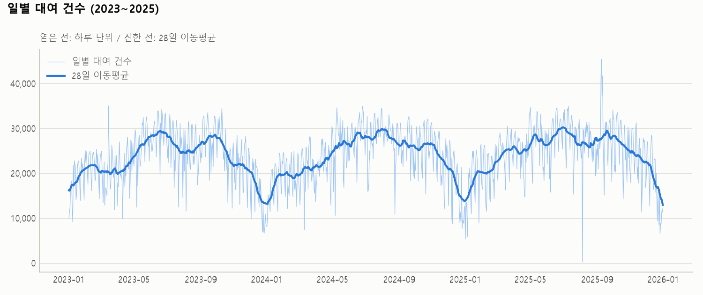
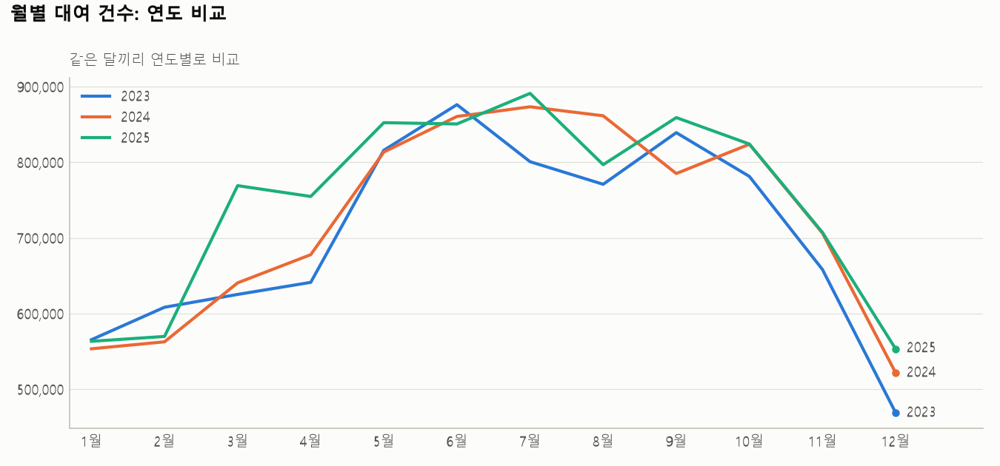
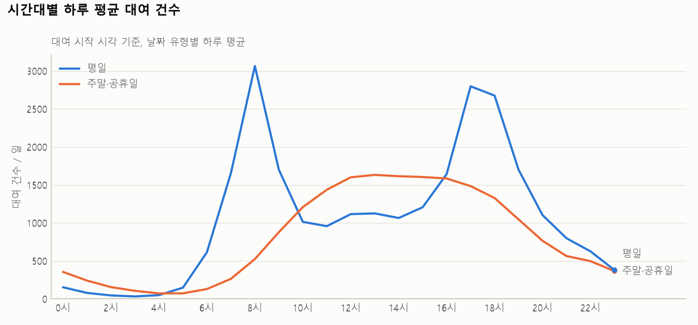
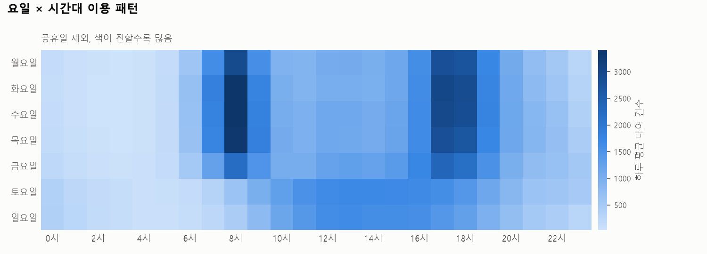
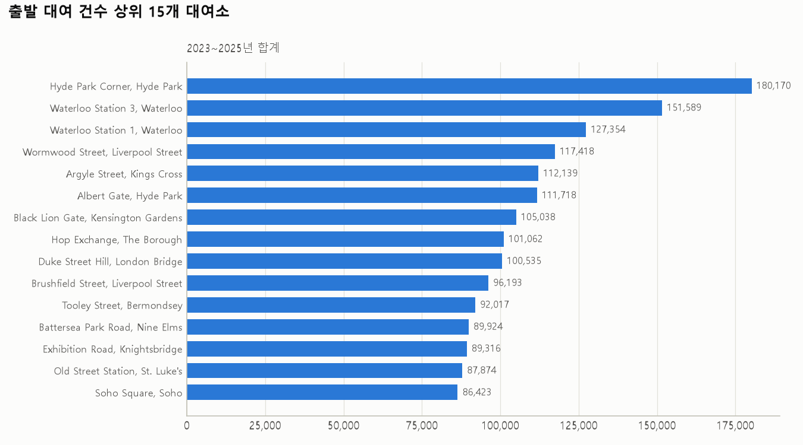
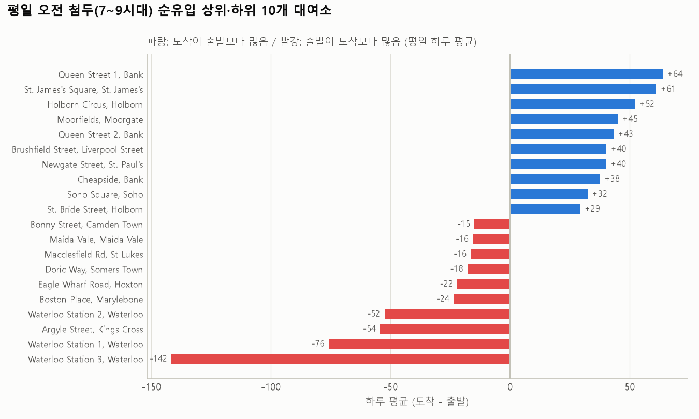
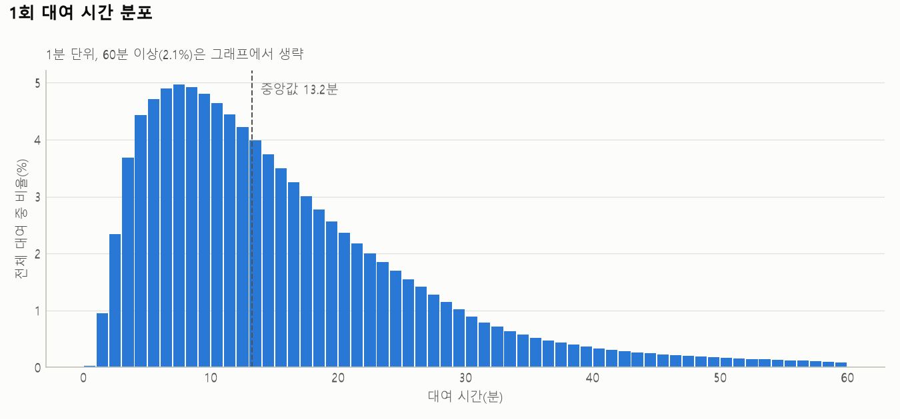
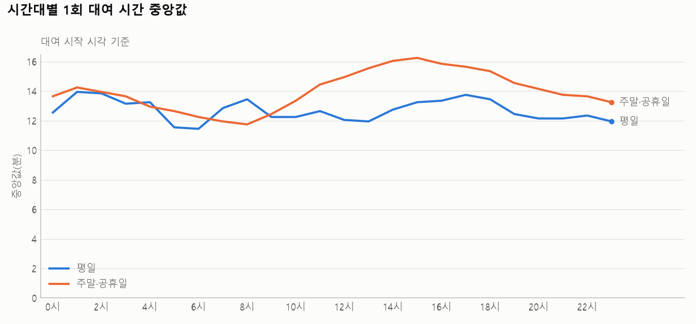
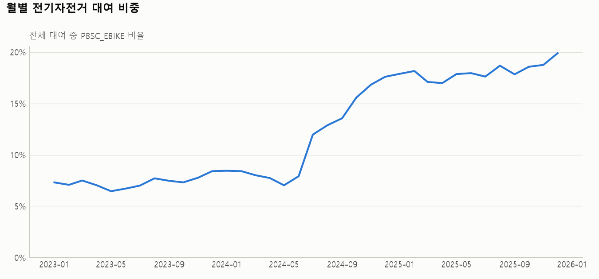

# 2차 — 데이터 확보·전처리·탐색적 데이터 분석(EDA)

혁신공유학부 배성윤 (2026-50713)

- 프로젝트: 런던 공공자전거(TfL Santander Cycles)의 시간·요일·대여소별 이용 패턴과 출발-도착 흐름 분석
- 작성일: 2026-11-16
- 관련 문서: 1차 기획서 `01_proposal/01_proposal.md`, 전처리 결정 기록 `docs/preprocessing_decisions.md`
- 표기 원칙: **관찰**(데이터에서 확인한 사실)과 **해석**(그로부터의 추론)을 나누어 쓴다. 해석은 외부 근거가 있으면 출처를 달고, 없으면 "가설"로 표시한다.

---

## 요약

- 1개월 Kaggle 사본 대신 **TfL 원 출처에서 3년치(86개 파일, 26,386,749행)**를 확보했다. 원데이터의 2023년 8월 행 수가 Kaggle 데이터(776,527행)와 정확히 같아 사본과 원본이 일치함을 확인했다.
- 품질 점검에서 **서머타임 때문에 시각과 대여 시간이 60분 어긋나는 현상**, **대여소 ID 표기 형식 변화(앞자리 0)**, **1분 이하 같은 대여소 왕복** 등을 발견했다. 이를 근거로 전처리 기준을 정해 **26,126,975행(99.016%)**과 **대여소 835개**를 분석 대상으로 확정했다.
- EDA 관찰: 평일에는 8시대·17~18시대의 두 피크 시간대가, 주말·공휴일에는 13~15시대의 완만한 concave 곡선이 나타난다. 평일 오전에는 Waterloo 역 대여소에서 출발이, Bank·Holborn 등 도심 대여소에 도착이 몰리고, 오후에는 반대가 된다.
- 하루 대여가 가장 많았던 4일(2025-09-08~11)은 지하철 파업 기간이었고, 가장 적었던 날(2025-08-05, 184건)은 대여 시스템 장애일이었다. 둘 다 외부 자료로 확인했다.

---

## 1. 1차 이후 변경된 프로젝트 내용

| 항목 | 1차 기획 | 2차 | 변경 이유 |
|---|---|---|---|
| 데이터 출처 | Kaggle 사본 | **TfL 공식 공개 데이터** | 원 출처 사용, 기간 확장 |
| 기간 | 2023-08 (1개월) | **2023-01-01 ~ 2025-12-31 (36개월)** | 1차에 한계로 적은 "계절 변화 확인 불가" 해소 |
| 규모 | 776,527행 | 26,126,975행 (전처리 후) | 위와 같음 |
| 대여소 단위 | 원본 ID | **정리된 대여소 이름(station_key)** | ID 표기 형식이 시기별로 달라 같은 대여소가 둘로 쪼개짐 (6.3절) |
| 1회 대여 시간 | `Total duration` | `duration_ms` (밀리초) 사용 | 시작·종료 시각은 서머타임 영향을 받음 (5.2절) |
| 날짜 구분 | 평일·주말 | **평일·주말·공휴일** | 3년치에는 공휴일이 섞여 결과에 영향 (8.1절) |
| 질문 3 | 모델별 대여 시간 비교 | **연도를 나눠 비교** | 전기자전거 비중이 7.3% → 18.1%로 변해 연도 효과와 섞임 (8.5절) |

분석 질문 1~3은 그대로 유지한다. 3차에서 최종 정리하며 다듬을 점은 12절에 적었다.

**분석 범위에 대한 결정**: 1차 피드백은 한 달 자료만으로는 연중 이용 특성을 설명하기 어려우므로 범위를 "2023년 8월 런던 공공자전거 이용 패턴"으로 명확히 설정하고, 다른 월은 기본 분석 뒤 확장 과제로 검토하라고 했다. 이 프로젝트는 다음 이유로 3년으로 확장했다.
1. 피드백이 먼저 요구한 **원자료 확인을 끝낸 뒤** 확장했다. TfL 원자료를 직접 내려받아 Kaggle 자료(2023년 8월)와 행 수가 같음을 확인했다 (3.2절).
2. 1개월 자료로는 "연중 이용 특성을 설명하기 어렵다"는 피드백의 지적 자체를 해소할 수 있다 (계절, 연도 비교).
3. 2023년 8월만 따로 본 결과가 3년 결과와 같은지 3차에서 비교해, 확장이 결론을 바꾸지 않는지 확인한다.

## 2. 1차 피드백 반영 내용

1차 발표 후 피드백 항목과 이후 반영 내용은 다음과 같다.

| 피드백 | 반영 내용 | 위치 |
|---|---|---|
| 다운로드 주소, 데이터 설명, 사용 조건 확인 | TfL 원자료 주소·설명·이용 조건(OGL 기반 TfL 라이선스, 출처 표기)을 데이터 개요표에 정리 | 3.1절 |
| 실제 행 수와 분석 기간 확인 | 원본 26,386,749행(2022-12-26~2025-12-31), 분석 26,126,975행(2023~2025년) | 3.1절, 6.1절 |
| 주요 컬럼의 의미와 대여시간 단위 | 표준 컬럼표 정리. 대여시간은 **밀리초**(`duration_ms`). 시작·종료 시각은 현지 시계 시각이라 서머타임 전환일에 60분 어긋남을 확인 | 4절, 5.2절 |
| Kaggle 자료와 TfL 원자료의 관계 | 2023년 8월 행 수 일치(776,527행). **확인한 것과 확인하지 못한 것을 구분**해 기록 | 3.2절 |
| 분석 범위를 2023년 8월로 명확히 | 원자료 확인 후 3년으로 확장하고 근거를 기록. 2023년 8월 결과와의 비교는 3차에서 수행 | 1절 |
| 중복·결측·비정상 대여시간의 건수와 처리 기준, 처리 전후 건수 | 기준별 제외 건수와 처리 전후 행 수 표 | 6.1절 |
| 일별 이용량, 시간대별 패턴, 평일·주말 비교, 대여시간 분포 | 그래프 9개와 날짜 유형별 표. 평일·주말은 날짜 수가 달라 **하루 평균**으로 비교. 대여시간 평균은 3차 보완 점검에서 추가 | 8절 |
| 대여소별 출발·도착 건수와 차이, 상위 OD(Origin-Destination, 출발 대여소와 도착 대여소의 쌍별 대여 건수), OD 합계 검산 | 상위 대여소·순유입·상위 흐름 정리. **OD 집계 합계 = 전체 대여 건수(26,126,975)** 확인. 전체 대여소 요약표는 3차 보완 점검에서 파일로 제공 | 8.4절, `eda_report.md` 0절 |
| 군집 특징 설계, 표준화, 이용 적은 대여소 기준 | 시간대별 출발·도착 **비율** 96개를 특징으로 설계(이용량이 아니라 모양 비교), 연 1,000건 미만 대여소 제외. 피드백이 제안한 특징 세트(일평균, 반납 비율, 대여시간 중앙값 등)를 표준화해 비교하는 분석은 3차에서 추가 | 12절, 3차 문서 |
| 관찰과 해석 구분 | 모든 EDA 절을 관찰/해석으로 나누고, 목적(출퇴근·여가)은 "유사한 패턴" 또는 "가설"로 표현. OD는 대여소 사이 대여 건수이지 실제 경로가 아님을 명시 | 8절 |
| LLM 결과 검증과 수정 기록 | 생성형 AI 코드의 검증 방법과 발견한 문제·수정 내용을 표로 기록 (12건) | 11절, `docs/preprocessing_decisions.md` 6절 |

## 3. 실제 데이터 확보 결과

### 3.1 데이터 개요표

| 항목 | 내용 |
|---|---|
| 데이터 | Santander Cycles(런던 공공자전거) 대여 기록, 1행 = 대여 1건 |
| 제공 기관 | Transport for London(TfL) |
| 다운로드 주소 | [cycling.data.tfl.gov.uk](https://cycling.data.tfl.gov.uk/#!usage-stats%2F) 의 `usage-stats` 폴더 (주 단위 CSV) |
| 확보 방법·일자 | 위 주소에서 파일을 직접 내려받아 `data/raw/`에 저장, 2026-11-14 |
| 파일 | 86개, 모두 같은 형식 (대여 시간이 밀리초인 최신 형식) — 목록은 `02_data-eda/merge_manifest.csv` |
| 원본 기간·행 수 | 2022-12-26 ~ 2025-12-31, **26,386,749행** |
| 분석 기간·행 수 | 2023-01-01 ~ 2025-12-31 (36개월), 전처리 후 **26,126,975행** (99.016%) |
| 대여소 수 | 원본 ID 1,252개(앞자리 0을 무시하면 833개), 원본 이름 845개 → 이름 통합 규칙으로 통일 후 **835개** (6.3절) |
| 자전거 모델 | `CLASSIC`(일반), `PBSC_EBIKE`(전기) |
| 주요 컬럼과 단위 | 대여 번호, 시작·종료 시각(**분 단위**, 영국 현지 시각), 출발·도착 대여소 번호와 이름, 자전거 번호·모델, 대여 시간(**밀리초** `Total duration (ms)`와 문자열 `Total duration`) — 4절 |
| 이용 조건 | Open Government Licence 2.0을 바탕으로 한 TfL 라이선스. **"Powered by TfL Open Data"** 표기 필요, TfL이 보증하는 것처럼 표현하면 안 됨 ([TfL, Transport Data Service 이용 약관](https://tfl.gov.uk/corporate/terms-and-conditions/transport-data-service)) |
| 개인정보 | 이용자 정보(이름, 회원 여부, 나이 등) 없음. 자전거 번호만 있으며 분석에 쓰지 않음 |

### 3.2 Kaggle 자료와 TfL 원자료의 관계

1차 기획서는 Kaggle 데이터셋 "London Bike-Share Usage Dataset"(2023년 8월, 776,527행)을 쓸 계획이었고, 그 설명에 원 출처가 TfL로 적혀 있었다.

| 구분 | 내용 | 근거 |
|---|---|---|
| **확인한 것** | TfL 원자료의 2023년 8월 대여 시작 건수가 **776,527행으로 Kaggle과 같다** | `merge_report.md` 3절 |
| **확인한 것** | TfL 원자료의 컬럼은 Kaggle 설명에 나온 11개 컬럼(Number, Start date, … , Total duration (ms))과 이름이 대응되고, 그 밖의 컬럼은 없다 (통합 시 대응되지 않은 컬럼 0개) | `merge_report.md` 2절 |
| **확인한 것** | TfL 발표 수치와도 맞는다: 2025-09-09 대여 TfL 발표 45,898건 vs 이 데이터 45,396건(전처리 후, 98.9%). 차이 1.1%는 전처리 제외 비율(약 1%)과 비슷 | [Cycling Weekly](https://www.cyclingweekly.com/news/moments-like-these-reinforce-how-vital-shared-bikes-have-become-lime-forest-and-santander-cycles-record-spike-in-use-amid-london-tube-strikes) |
| 확인하지 못한 것 | Kaggle 파일의 **값**이 TfL 원자료와 행 단위로 같은지 (행 수만 비교함) | — |
| 확인하지 못한 것 | Kaggle 제공자가 정렬·필터·형식 변환 등 가공을 했는지 (데이터셋 설명에 가공 내역이 없음) | — |
| 확인하지 못한 것 | Kaggle 데이터셋 자체의 라이선스 | — |

- 결론: 원 출처인 TfL 자료를 직접 쓰므로 Kaggle 가공 여부는 이 프로젝트의 결과에 영향을 주지 않는다. Kaggle 자료는 2023년 8월의 **대조 기준**으로만 썼다.

## 4. 데이터 구조 및 주요 컬럼

통합 단계(`00_merge_raw.py`)에서 원본 컬럼을 표준 이름으로 통일했다. 형식만 바꾸고 값과 행은 바꾸지 않았다(읽은 행 수 = 저장한 행 수를 자동 확인).

| 표준 컬럼 | 원본 컬럼 | 자료형 | 설명 |
|---|---|---|---|
| `trip_id` | Number | 정수 | 대여 고유 번호 |
| `start_time`, `end_time` | Start date, End date | 날짜시각(분 단위) | 대여 시작·종료 시각 (영국 현지 시각) |
| `start_station_id`, `end_station_id` | Start/End station number | 문자열 | 대여소 번호 (앞자리 0 보존을 위해 문자열) |
| `start_station_name`, `end_station_name` | Start/End station | 문자열 | 대여소 이름 |
| `bike_id` | Bike number | 문자열 | 자전거 번호 |
| `bike_model` | Bike model | 문자열 | `CLASSIC` / `PBSC_EBIKE` |
| `duration_ms` | Total duration (ms) | 실수 | 1회 대여 시간 (밀리초) |
| `source_file` | (추가) | 문자열 | 원본 파일명 (추적용) |

## 5. 데이터 품질 확인

점검 결과 전체는 `02_data-eda/data_check_report.md`에 있다. 이 단계에서도 데이터는 수정하지 않았다.

### 5.1 결측·중복·자료형

| 항목 | 결과 |
|---|---|
| 결측 | 종료 일시·도착 대여소·대여 시간이 함께 빠진 행 184건(0.001%), 자전거 ID 결측 1건. 나머지 컬럼 0건 |
| `trip_id` 중복 | 0건 |
| 내용 중복 | `trip_id`만 다르고 자전거·시작·종료·출발·도착이 모두 같은 행 463행 (원본+사본) |
| 날짜 변환 실패 | 0건, 시각은 모두 **분 단위**로 기록됨 (초 값이 전부 0) |
| 자료형 | 대여소 ID에 숫자가 아닌 값 2개(`001057_old`, `200217old2`) → 문자열로 보존 |

### 5.2 날짜 논리와 서머타임

- **관찰**: `duration_ms`와 (종료 − 시작)의 차이는 99.995%가 1분 이내였다. 나머지 **1,236건은 모두 55~65분 차이**였고 다른 구간은 0건이었다. 이 행들은 2023-03-26, 2024-03-31, 2025-03-30, 2023-10-29, 2024-10-27, 2025-10-26과 그 전날들에 몰려 있다.
- **관찰**: 종료 시각이 시작 시각보다 빠른 185건은 **전부** 2023-10-29(48), 2024-10-27(71), 2025-10-26(66)에 발생했다.
- **해석**: 이 날짜들은 영국의 서머타임 시작일(3월 마지막 일요일)과 해제일(10월 마지막 일요일)이다 ([GOV.UK](https://www.gov.uk/when-do-the-clocks-change)). 시작·종료 시각은 현지 시계 시각이고 `duration_ms`는 실제 경과 시간으로 판단했다.

### 5.3 이상값: 1회 대여 시간

- **관찰**: 중앙값 13.15분, 99% 지점 91.3분, 99.9% 지점 1,054.2분(약 17.6시간), 최댓값 301,435분(약 209일). 24시간 초과 21,249건(0.081%).
- **관찰**: 1분 이하 대여 196,531건 중 **189,903건(약 96.6%)이 같은 대여소에서 빌려 같은 곳에 반납**한 경우였다.

### 5.4 대여소 ID와 이름

- **관찰**: 대여소 ID 1,252개, 이름 845개. 앞자리 0을 무시하면 ID는 **833개**이고, 같은 번호가 `000964`와 `964` 두 형태로 함께 나타나는 경우가 **419개**였다.
- **관찰**: 같은 이름의 여러 ID가 같은 달에 함께 쓰인 경우는 거의 없었다(422개 대여소 중 419개가 0개월).
- **해석**: 같은 대여소의 **ID 표기 형식이 시기별로 달라진 것**으로 보인다. ID 그대로 분석하면 한 대여소가 시기별로 둘로 쪼개진다.

### 5.5 연도별 구성

- **관찰**: 전기자전거(PBSC_EBIKE) 비중이 2023년 7.3% → 2024년 11.3% → 2025년 18.1%로 늘었다.

## 6. 전처리 기준 및 처리 결과

각 기준의 근거·대안·이후 확인 사항은 `docs/preprocessing_decisions.md`(결정 D1~D10)에 자세히 적었다. 스크립트: `02_preprocess.py`, 결과: `02_data-eda/preprocess_log.md`.

### 6.1 행 제외 기준과 결과 (적용 순서대로)

| # | 기준 | 근거 (5절) | 제외 | 전체 대비 | 남은 행 |
|---|---|---|---:|---:|---:|
| 0 | 통합 데이터 | | - | - | 26,386,749 |
| 1 | 분석 기간 2023-01-01 ~ 2025-12-31 밖 | 2022-12는 26일부터만 있음 | 48,901 | 0.185% | 26,337,848 |
| 2 | 반납 정보 결측 | 흐름·대여 시간 계산 불가 | 184 | 0.001% | 26,337,664 |
| 3 | 종료 < 시작 중 서머타임으로 설명 안 되는 행 | 185건 전부 해제일 → 0건 제외 | 0 | 0.000% | 26,337,664 |
| 4 | 내용 중복 (사본만 제외) | 463행 = 원본 + 사본 | 237 | 0.001% | 26,337,427 |
| 5 | 같은 대여소 왕복 + 1분 이하 | 1분 이하의 96.6%가 왕복 | 189,287 | 0.717% | 26,148,140 |
| 6 | 24시간 초과 | 하루 넘는 대여는 한 번의 이동으로 보기 어려움 | 21,165 | 0.080% | 26,126,975 |
| | **최종 분석 데이터** | | | **99.016%** | **26,126,975** |

- 검산: 통합 행 수 − 제외 합계 = 최종 행 수 → 일치.
- 5번과 6번은 정답이 정해진 기준이 아니라 판단이므로, 3차에서 **기준을 바꿔도(2분, 3시간) 결론이 유지되는지** 확인한다.

### 6.2 값 처리

- 1회 대여 시간은 `duration_ms`를 사용한다 (5.2절).
- 종료 < 시작 185건은 `duration_ms`가 정상이므로 유지하고, 시간대 분석은 **시작 시각 기준**으로 한다.

### 6.3 대여소 통일 (원본 ID·이름 1,268쌍 → 대여소 835개)

| 규칙 | 내용 | 예 |
|---|---|---|
| A. 표기 정리 | 공백, 쉼표 앞뒤 공백 정리 | `Kennington Road  , Vauxhall` → `Kennington Road, Vauxhall` |
| B. 표기 변형 | 같은 ID 안에서 가장 많이 쓰인 이름과 철자 유사도 0.9 이상이면 통일 | `St. Lke's` → `St. Luke's` |
| C. 이름 기준 | 정리된 이름이 같으면 ID가 달라도 같은 대여소 | `000964` / `964` |
| D. 이름 변경 | 같은 ID에서 지역명(쉼표 뒤)이 같고 동시에 쓰이지 않은 이름은 통합. 지역이 다르거나 **운영 중인 다른 ID의 이름**이면 분리 | `Bayley Street` → `Percy Street, Bloomsbury` 통합 / `Clapham South` ↔ `Coomer Place, West Kensington` 분리 |

**규칙을 고친 과정 (검증 사례)**
- 1차 실행 후, 같은 ID인데 이름이 달라 분리된 10건을 직접 확인하니 같은 동네에서 이름만 바뀐 경우가 섞여 있어 규칙 D를 추가했다.
- 2차 실행에서 "여러 ID가 같은 달에 함께 쓰였는지" 검사가 `Fore Street`(300222)와 `Fore Street Avenue`(200253)를 검토 대상으로 표시했다. **두 ID가 37개월 동안 동시에 운영된 서로 다른 대여소**였는데, 한 달쯤 이름이 서로 뒤바뀌어 기록되어 규칙 D가 잘못 합친 것이다. 조건을 보완해 분리했다.
- 최종 결과: 여러 ID가 3개월 이상 동시에 쓰인 대여소 0개. 잘못 합쳤을 때 늘었던 짧은 왕복 23건(두 대여소 사이의 짧은 이동)도 분리 후 사라졌다.

## 7. 주요 파생 변수

| 변수 | 정의 | 쓰는 곳 |
|---|---|---|
| `duration_min` | `duration_ms` / 60,000 | 질문 3 |
| `start_hour` | 대여 시작 시각의 시 | 질문 1, 3 |
| `day_of_week`, `is_weekend` | 요일(0=월), 토·일 여부 | 질문 1, 3 |
| 날짜 유형 / `workday` | 평일·주말·공휴일 / 평일 여부 (공휴일: 잉글랜드·웨일스 bank holiday, [GOV.UK](https://www.gov.uk/bank-holidays)) | 질문 1, 2, 3 |
| `year`, `month`, `season` | 연·월·계절 (12~2월 겨울, 3~5월 봄, 6~8월 여름, 9~11월 가을) | EDA, 질문 3 |
| `start_station_key`, `end_station_key` | 6.3절 규칙으로 통일한 대여소 | 질문 1, 2 |
| `is_round_trip` | 출발·도착 대여소가 같음 | 질문 3 (설명용) |

## 8. 탐색적 데이터 분석(EDA)

스크립트: `03_eda.py`. 2,600만 행을 파일별로 집계해 누적했고, 집계 테이블은 `data/agg/`에 저장해 3차 분석과 최종 보고서에서 다시 쓴다. **모든 집계의 합계가 26,126,975행과 일치**함을 확인했다(`eda_report.md` 0절). 상세 수치는 `02_data-eda/eda_report.md`에 있다.

### 8.1 연도·일별 추이



| 연도 | 대여 건수 | 하루 평균 | 전년 대비 | 평일 평균 | 주말 평균 | 공휴일 평균 |
|---|---:|---:|---:|---:|---:|---:|
| 2023 | 8,452,812 | 23,158 | | 25,126 | 19,066 | 16,025 |
| 2024 | 8,681,509 | 23,720 | +2.7% | 25,406 | 20,238 | 15,443 |
| 2025 | 8,992,654 | 24,637 | +3.6% | 26,732 | 20,291 | 14,908 |

**관찰**
- 매년 여름에 많고 겨울(특히 12월 말~1월 초)에 적은 주기가 나타난다.
- 주말 평균은 평일의 약 76~80% 수준이고, 공휴일 평균은 주말보다도 낮다.
- 연 대여 건수는 2년 연속 늘었다.

**특이 날짜와 외부 확인**

| 날짜 | 대여 건수 | 관찰 | 외부 자료 |
|---|---:|---|---|
| 2025-09-08 ~ 11 (월~목) | 40,880 / 45,396 / 37,182 / 41,688 | 3년 중 상위 1~4위 | RMT 노조의 지하철 파업 기간(9월 8일~12일 아침). TfL 발표 9월 9일 대여 45,898건은 전주 같은 요일(26,678건)보다 72% 많음 ([Cycling Weekly](https://www.cyclingweekly.com/news/moments-like-these-reinforce-how-vital-shared-bikes-have-become-lime-forest-and-santander-cycles-record-spike-in-use-amid-london-tube-strikes)) |
| 2023-03-15 (수) | 34,984 | 상위 5위 | 예산안 발표일 대규모 파업. 지하철은 "운행이 거의 또는 전혀 없을 것"으로 안내됨 ([LBC](https://lbc.co.uk/news/junior-doctors-teachers-and-tube-drivers-among-hundreds-of-thousands-of-workers)) |
| 2025-08-05 (화) | **184** | 3년 중 최저, 평일인데 다른 날의 1% 미만 | 계획된 소프트웨어 업그레이드가 지연되어 앱과 대여소 모두에서 대여가 불가능했던 장애 ([AOL/BBC 보도](https://www.aol.com/news/app-outage-leaves-users-unable-122040604.html), [inkl](https://www.inkl.com/news/santander-bikes-out-of-order-across-london-due-to-tech-error-tfl-says)) |
| 2025-01-05 (일) | 5,885 | 하위 3위 | 잉글랜드 남부에 노란색 호우 경보 ([Met Office](https://www.metoffice.gov.uk/about-us/news-and-media/media-centre/weather-and-climate-news/2025/snow-continues-over-northern-england-and-scotland-turning-to-rain-further-south)) |
| 2024-12-08 (일) | 8,667 | 하위 14위 | 전날(12월 7일) 폭풍 Darragh가 영국을 통과, 잉글랜드 전역 노란색 강풍 경보가 다음 날까지 ([Met Office](https://acct.metoffice.gov.uk/about-us/news-and-media/media-centre/weather-and-climate-news/2024/storm-darragh-brings-90mph-gusts-and-heavy-rain)). 관련 가능성은 있으나 확정할 수 없음 |
| 12월 24일 ~ 1월 1일 | 하위 15일 중 11일 | 연말연시 | 크리스마스·박싱데이·새해 공휴일 기간 |
| 2024-03-10 (일) | 7,399 | 하위 8위 | 관련 사건을 확인하지 못함 |

**해석**
- 지하철 운행이 줄어든 날 자전거 대여가 크게 늘었다. 일부 이용자에게 공공자전거가 **지하철의 대체 수단**으로 쓰인 것으로 보인다 (외부 근거 있음).
- 2025-08-05는 수요가 아니라 **공급이 끊긴 날**이다. 이 날을 하루 단위 평균이나 월 비교에 그대로 넣으면 2025년 8월이 실제보다 낮아 보인다. 2025년 8월은 전년보다 7.5% 적은데, 그중 일부는 이 장애 때문이다. 3차의 날짜 단위 비교에서는 이 날을 **운영 장애일로 표시해 제외**한다.
- 공휴일 평균이 주말보다 낮은 것은 해마다 공휴일 8~9일 중 3일이 크리스마스·박싱데이·새해에 몰려 있는 구성 효과일 수 있다 (가설: 3차에서 계절을 통제해 확인).
- 2025년 증가분에는 파업 4일과 맑은 봄(8.2절)이 포함되어 있어, 연간 증가를 하나의 원인으로 설명할 수 없다.

### 8.2 월별·계절



**관찰**
- 2025년 3월 대여(769,179건)는 2023년 3월보다 23.0%, 2024년 3월보다 20.1% 많았다. 2025년 봄의 하루 평균(25,832건)도 이전 두 해(22,638, 23,177건)보다 높았다.
- 겨울의 하루 평균은 세 해 모두 약 18,000~18,700건으로 비슷했다.

**해석**
- 2025년 3월은 잉글랜드에서 1910년 기록 시작 이후 가장 맑은 3월이었고, 강수량은 평년의 약 25%였다 ([Met Office](https://www.metoffice.gov.uk/about-us/news-and-media/media-centre/weather-and-climate-news/2025/a-record-breaking-march-for-sunshine)). 날씨가 3월 증가와 관련 있을 가능성이 크다. 다만 이 데이터에는 날씨 변수가 없고 전기자전거 확대도 같은 시기에 진행되어, 날씨의 영향만 따로 떼어 말할 수는 없다.

### 8.3 시간대·요일





**관찰**
- 평일: 8시대(하루 평균 3,065건), 17시대(2,798건), 18시대(2,676건)가 가장 많다. 7~9시대에 하루 대여의 24.9%, 16~18시대에 27.6%가 몰려, **6시간 동안 하루의 52.5%**가 발생한다.
- 주말·공휴일: 13~15시대(약 1,600건)가 가장 많고, 11시대~16시대가 고르게 높다. 0~3시대는 평일보다 많다.
- 요일별(공휴일 제외): 화·수·목(약 26,400~27,000건)이 가장 많고, 월(24,724건)과 금(23,945건)은 화~목 평균보다 각각 약 7%, 10% 적다.

**해석**
- 평일의 두 피크 시간대는 **출퇴근 시간대와 유사한 이용 패턴**이고, 주말의 오후 concave 곡선은 낮 시간에 고르게 퍼진 이용이다. 이용 목적은 데이터에 없어 출퇴근·여가 여부를 확정할 수는 없다 (가설). 질문 1(대여소 유형)의 출발점이 되는 관찰이다.
- 월·금이 적은 것은 재택근무 등 주중 출근일 차이와 관련 있을 수 있다 (가설: 이 데이터로 확인할 수 없음).

### 8.4 대여소별 이용과 흐름 (질문 1·2 사전 탐색)





**관찰**
- 분석 기간에 이용된 대여소는 835개(연도별 811, 812, 822개)다. 2023→2024년 새로 나타난 대여소 9개·사라진 대여소 8개, 2024→2025년 각각 17개·7개.
- 출발 기준 상위 10% 대여소(84개)가 전체 출발의 23.4%를 차지한다. 대여소별 출발 건수 중앙값은 28,309건(최대 180,170건, 최소 0건 = 도착만 기록된 대여소).
- **평일 오전 피크 시간대(7~9시대) 순유입(도착 − 출발, 평일 하루 평균)**
  - 출발이 많은 곳: Waterloo Station 3 (−141.5), Waterloo Station 1 (−75.8), Argyle Street, Kings Cross (−54.3), Waterloo Station 2 (−52.5)
  - 도착이 많은 곳: Queen Street 1, Bank (+63.8), St. James's Square (+61.0), Holborn Circus (+52.1), Moorfields, Moorgate (+45.0)
- **평일 오후 피크 시간대(16~18시대)**에는 방향이 반대다. Waterloo Station 3 (+151.9), Waterloo Station 1 (+60.5), Argyle Street, Kings Cross (+50.8)에 도착이 많고, Bank·St. Paul's 일대에서 출발이 많다.
- 출발-도착 대여소 쌍은 554,807개이고, 출발한 대여소에 반납한 대여(왕복)의 비중은 2.92%다. 가장 많은 편도 흐름은 `Ackroyd Drive, Bow` ↔ `Maplin Street, Mile End`(양방향 10,299 / 9,254건), Hyde Park 안의 대여소 사이, `Hackney Wick` ↔ `Stratford Station`이다.
- 출발-도착(OD) 집계의 합계는 전체 대여 건수 26,126,975건과 같다 (`eda_report.md` 0절).
- OD 표는 **출발 대여소와 도착 대여소 사이의 대여 건수**다. 실제로 어떤 길로 달렸는지(주행 경로)는 데이터에 없다.

**해석**
- Waterloo와 King's Cross는 런던의 주요 철도역이다. 오전에 역 이름의 대여소에서 출발이, 도심(Bank, Holborn, Moorgate) 대여소에 도착이 몰리고 저녁에는 반대가 되는 모습은 **출퇴근 시간대와 유사한 패턴**이다. 철도로 도착한 통근자가 마지막 구간을 자전거로 이동하는 것일 수 있지만, 이용자 정보가 없어 확인할 수 없다 (가설).
- 이 방향성은 질문 2의 "출발과 도착이 불균형한 대여소"가 **시간대에 따라 방향이 바뀐다**는 뜻이다. 하루 전체로 합치면 상쇄되어 보이지 않을 수 있으므로, 3차에서는 불균형을 **시간대별로** 정의한다.
- 출발이 도착보다 많다는 결과는 재배치 검토의 단서가 될 수 있지만, 실제 자전거 부족 여부는 재고·대여소 용량 자료가 있어야 판단할 수 있다.
- Hyde Park 안의 대여소 사이 흐름이 많다는 것은 관찰이며, 여가 목적인지는 확인할 수 없다. `Bow` ↔ `Mile End` 흐름이 많은 이유도 확인하지 못했다.

### 8.5 1회 대여 시간 (질문 3 사전 탐색)





| 구분 | 대여 건수 | 25% | 중앙값 | 75% |
|---|---:|---:|---:|---:|
| 전체 | 26,126,975 | 7.8분 | 13.2분 | 21.4분 |
| 평일 | 19,522,978 | 7.6분 | 12.8분 | 20.4분 |
| 주말·공휴일 | 6,603,997 | 8.2분 | 14.6분 | 24.8분 |
| 편도 | 25,364,617 | 7.8분 | 13.0분 | 20.8분 |
| 왕복 | 762,358 | 14.2분 | 27.2분 | 47.1분 |

| 연도 | 일반 자전거 중앙값 | 전기자전거 중앙값 | 전기자전거 비중 |
|---|---:|---:|---:|
| 2023 | 13.0분 | 14.4분 | 7.3% |
| 2024 | 13.0분 | 14.8분 | 11.3% |
| 2025 | 13.0분 | 15.2분 | 18.1% |



**관찰**
- 분포는 오른쪽 꼬리가 길다 (95% 지점 42.6분, 99% 지점 87.7분).
- 주말·공휴일과 왕복 대여가 더 길다.
- 매년 전기자전거의 중앙값이 일반 자전거보다 1.4~2.2분 길고, 그 차이는 해마다 커졌다. 일반 자전거 중앙값은 세 해 모두 13.0분이다.

**해석**
- 왕복 대여(출발한 대여소에 반납)는 편도보다 두 배 이상 길다. 출발지로 돌아왔다는 사실만 알 수 있고, 중간에 어디를 들렀는지나 목적(여가 등)은 확인할 수 없다.
- 전기자전거가 더 긴 것은 더 먼 거리를 이동하기 때문일 수 있다. 하지만 **이 데이터에는 위치 좌표가 없어 이동 거리를 확인할 수 없다** (가설).
- 꼬리가 긴 분포라 평균은 긴 대여에 크게 끌려간다. 따라서 **중앙값·분위수**로 비교하고, 3차 모델은 로그 변환한 대여 시간을 쓰는 것이 적합하다. 피드백에 따른 평균과 중앙값의 비교는 3차 보완 점검(`feedback_checks.md`)에 정리했다.

## 9. 초기 분석 결과 요약

| 질문 | 관찰 | 해석 (확인 수준) | 3차에서 할 일 |
|---|---|---|---|
| 1. 시간·요일 패턴과 대여소 유형 | 평일 두 피크 시간대, 주말 오후 concave 곡선 / 피크 시간대 시간대 순유입 방향이 역 이름의 대여소와 도심 대여소에서 반대 | 평일 오전 출발 집중·도착 집중 대여소가 나뉠 가능성 (가설) | 대여소별 시간대 이용 비율로 군집화 |
| 2. 흐름과 불균형 | 오전엔 Waterloo·King's Cross에서 출발, 도심에 도착 / 오후엔 반대 | 출퇴근 시간대와 유사한 패턴. 철도 통근의 마지막 구간일 가능성 (가설, 미확인) | 시간대별 불균형 지표 정의, 연도별 일관성 확인 |
| 3. 1회 대여 시간 | 주말·왕복·전기자전거가 김 / 일반 자전거 중앙값 3년 동일 | 전기자전거는 더 먼 이동일 가능성 (가설). 왕복·주말 대여의 목적은 알 수 없음 | Baseline 대비 모델, 연도 기준 Train/Test |
| (EDA) 특이 날짜 | 파업일 급증, 장애일 급감, 맑은 봄 증가 | 외부 자료로 확인 | 장애일 표시·제외, 공휴일·계절 통제 |

## 10. 한계 및 추가 확인 사항

- **위치 좌표가 없다**: 이동 거리, 대여소 주변 환경(역·업무지구·공원)은 이름으로만 추정할 수 있다. 대여소 이름 변경이 같은 자리인지도 확인할 수 없다.
- **날씨 자료가 없다**: 날씨와의 관계는 특정 날짜를 외부 자료로 확인하는 수준이다.
- **이용자 정보가 없다**: 회원 여부, 목적, 연령을 알 수 없어 "통근", "여가"는 시간·장소 패턴에서 추론한 해석이다.
- **주행 경로가 없다**: 출발·도착 대여소만 있어 실제로 달린 길은 알 수 없다. OD는 대여소 사이의 대여 건수다.
- **대여소 재고·용량 정보가 없다**: 불균형이 실제로 자전거 부족이나 반납 불가로 이어졌는지는 알 수 없다.
- **운영 장애일**: 2025-08-05는 공급이 끊긴 날이다. 다른 장애일이 있는지 3차에서 시간대 분포로 점검한다.
- **전처리 기준의 판단 요소**: 짧은 왕복(1분)·긴 대여(24시간) 기준을 바꿔도 결론이 같은지 3차에서 확인한다.
- **일반화 범위**: 결과는 2023~2025년 런던 TfL 공공자전거에 한정된다. 다른 도시나 다른 공유자전거 서비스(예: 도크 없는 전기자전거)로 일반화하지 않는다.

## 11. 생성형 AI 활용 및 검증

AI로 통합·점검·전처리·EDA 코드를 작성했고, 아래처럼 **실제 실행 결과로 검증**하며 수정했다. 상세 기록은 `docs/preprocessing_decisions.md` 6절에 있다.

| 단계 | AI 결과물 | 검증 방법 | 발견한 문제 → 수정 |
|---|---|---|---|
| 통합 | 여러 형식 파일 통합 코드 | 파일별 읽은 행 수 = 저장 행 수 자동 확인, Kaggle 행 수와 대조 | 영국식 날짜(일/월) 오해석 위험 → 후보 형식으로 판별 |
| 점검 | 품질 점검 코드 | 대여 시간 컬럼과 (종료 − 시작)의 차이를 구간별로 셈 | 60분 차이가 서머타임 날짜에 집중 → `duration_ms` 사용 결정 |
| 전처리 | 대여소 통일 규칙 | 실제 로그의 사례를 읽고, 정답을 아는 가짜 데이터로 재현 | 이름 변경 미처리 → 규칙 D 추가 / Fore Street 잘못 합침 → 조건 보완 |
| 해석 | "ID 체계가 바뀌었다"는 AI의 첫 해석 | 앞자리 0을 무시한 ID 수를 직접 셈 (1,252 → 833) | "ID 표기 형식 변경"으로 정정 |
| EDA | 집계·그래프 코드 | 모든 집계 합계 = 행 수 검산, 그래프를 직접 열어 확인 | 눈금 반올림 중복, 라벨 겹침, 기호 깨짐 수정 |
| EDA | 특이 날짜 | 외부 자료(TfL 발표 수치, 언론, Met Office)와 대조 | 9월 9일 TfL 발표 45,898건 vs 데이터 45,396건 (차이 1.1% ≈ 전처리 제외 비율) |

## 12. 다음 단계 (3차 계획)

| 질문 | 방법 | 검증 |
|---|---|---|
| 1. 대여소 유형 | 평일·비평일 시간대별 출발·도착 비율(대여소당 96차원)로 K-means 군집화. 충분히 이용된 대여소만 사용 | 군집 수 근거(실루엣, 엘보), 연도를 나눠 다시 군집화했을 때 결과 일치도(ARI), 단순 규칙(오전 순유입 방향) 기반 분류와 비교 |
| 2. 흐름·불균형 | 시간대별 불균형 지수 = (도착 − 출발) / (도착 + 출발), 주요 흐름 | 지수의 분포를 보고 "크게 불균형"의 기준 정의, 연도별 순위 상관으로 일관성 확인 |
| 3. 대여 시간 | 표본 데이터로 로그 대여 시간 회귀 (시간대, 요일 유형, 계절, 연도, 모델, 출발 대여소 유형) | Baseline(시간대별 중앙값) 대비 MAE, **2023~2024 학습 / 2025 검증**, 대여 시작 시점에 알 수 없는 정보(도착 대여소, 왕복 여부)는 특성에서 제외해 Data Leakage 방지 |
| 공통 | 운영 장애일 표시·제외, 전처리 기준 민감도(2분, 3시간) | 기준을 바꿔도 결론이 유지되는지 비교 |

## 재현 방법

```
python 00_merge_raw.py      # data/raw → data/interim/trips (형식 통일)
python 01_check_data.py     # 품질 점검 보고서
python 02_preprocess.py     # data/interim → data/processed/trips (전처리)
python 03_eda.py            # data/agg 집계, 그래프, EDA 보고서
```

- 필요 패키지: pandas, pyarrow, openpyxl, tabulate, matplotlib
- 원본·중간 데이터(`data/raw/`, `data/interim/`, `data/processed/`)는 용량 때문에 저장소에 올리지 않는다. 집계 결과(`data/agg/`)와 공휴일 목록(`data/external/`)은 올린다.

---

Powered by TfL Open Data. 이 프로젝트는 TfL과 관련이 없으며 TfL의 보증을 받지 않았다.

## 출처

- [TfL Cycling Data, usage-stats](https://cycling.data.tfl.gov.uk/#!usage-stats%2F) (원자료, 2026-11-14 다운로드)
- [TfL, Transport Data Service 이용 약관](https://tfl.gov.uk/corporate/terms-and-conditions/transport-data-service)
- [GOV.UK, UK bank holidays](https://www.gov.uk/bank-holidays)
- [GOV.UK, When do the clocks change?](https://www.gov.uk/when-do-the-clocks-change)
- [Cycling Weekly, Lime, Forest and Santander Cycles record spike in use amid London tube strikes](https://www.cyclingweekly.com/news/moments-like-these-reinforce-how-vital-shared-bikes-have-become-lime-forest-and-santander-cycles-record-spike-in-use-amid-london-tube-strikes)
- [LBC, Junior doctors, teachers, and Tube drivers among hundreds of thousands of workers staging mass Budget Day strike](https://lbc.co.uk/news/junior-doctors-teachers-and-tube-drivers-among-hundreds-of-thousands-of-workers)
- [AOL (BBC 보도), App outage leaves users unable to hire bikes](https://www.aol.com/news/app-outage-leaves-users-unable-122040604.html)
- [inkl, Santander bikes out of order across London due to tech error, TfL says](https://www.inkl.com/news/santander-bikes-out-of-order-across-london-due-to-tech-error-tfl-says)
- [Met Office, A record-breaking March for sunshine](https://www.metoffice.gov.uk/about-us/news-and-media/media-centre/weather-and-climate-news/2025/a-record-breaking-march-for-sunshine)
- [Met Office, Storm Darragh brings 90mph gusts and heavy rain](https://acct.metoffice.gov.uk/about-us/news-and-media/media-centre/weather-and-climate-news/2024/storm-darragh-brings-90mph-gusts-and-heavy-rain)
- [Met Office, Snow continues over northern England and Scotland, turning to rain further south](https://www.metoffice.gov.uk/about-us/news-and-media/media-centre/weather-and-climate-news/2025/snow-continues-over-northern-england-and-scotland-turning-to-rain-further-south)