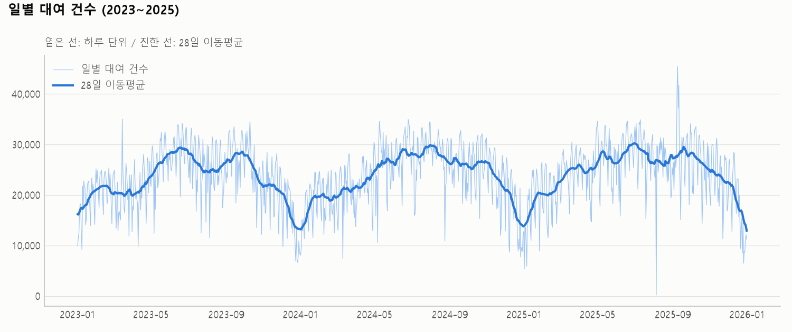
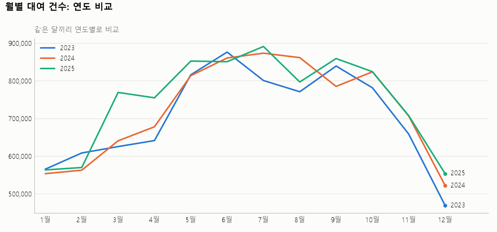
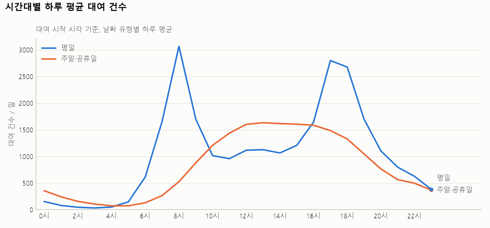
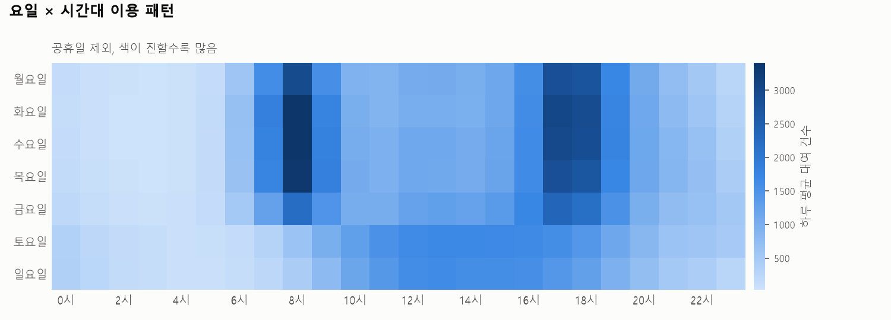
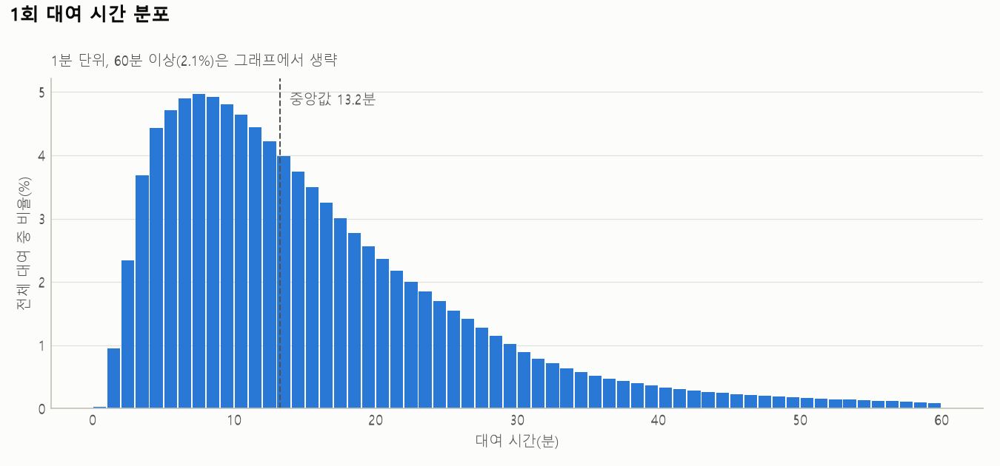
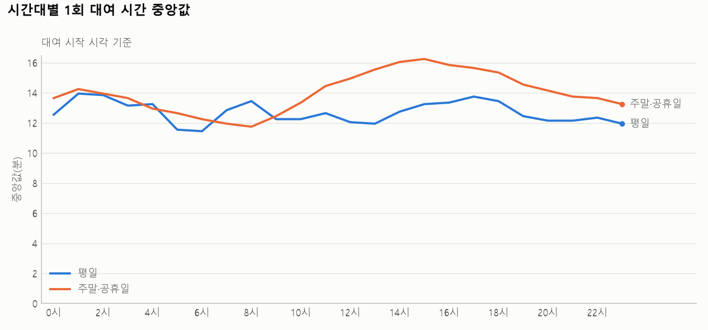
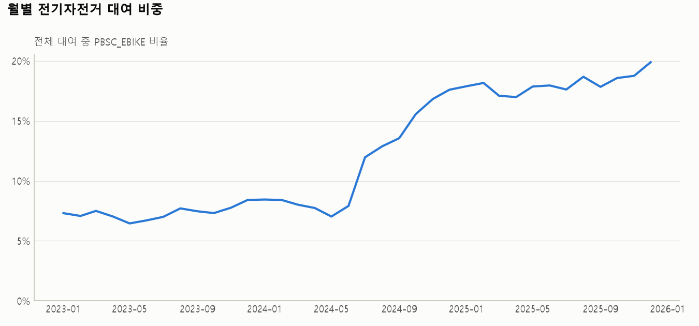
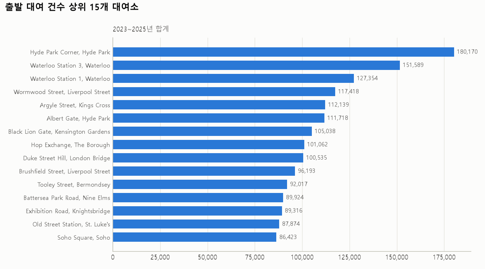
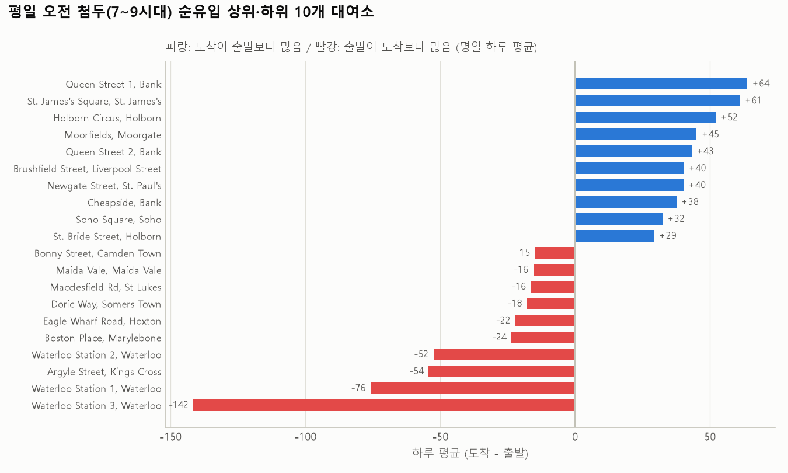

# 탐색적 데이터 분석(EDA) 결과

- 실행 일시: 2026-11-23 17:06
- 입력: `data/processed/trips/` (26,126,975행), 집계 테이블: `data/agg/`
- 이 보고서는 **관찰(수치)**만 기록한다. 해석은 그래프와 표를 보고 별도로 작성한다.
- 날짜 구분: 평일(월~금, 공휴일 제외) / 주말 / 공휴일(잉글랜드·웨일스 bank holiday, [GOV.UK](https://www.gov.uk/bank-holidays))

## 0. 집계 검산

모든 집계의 합계가 원본 행 수와 같아야 한다.

| 항목             |         건수 |
|:---------------|-----------:|
| 원본 행 수         | 26,126,975 |
| 일별 집계 합계       | 26,126,975 |
| 시간대 집계 합계      | 26,126,975 |
| 대여소 출발 합계      | 26,126,975 |
| 대여소 도착 합계      | 26,126,975 |
| 출발-도착(OD) 합계   | 26,126,975 |
| 대여 시간 히스토그램 합계 | 26,126,975 |

- 결과: **모두 일치**

- 대여가 0건인 날: 0일 []

## 1. 연도별 규모

|   연도 |      대여건수 |   일수 |   하루 평균 | 전년 대비   |
|-----:|----------:|-----:|--------:|:--------|
| 2023 | 8,452,812 |  365 |  23,158 |         |
| 2024 | 8,681,509 |  366 |  23,720 | +2.7%   |
| 2025 | 8,992,654 |  365 |  24,637 | +3.6%   |

## 2. 일별 추이

날짜 유형별 하루 평균 대여 건수:

|   연도 |     평일 |     주말 |    공휴일 |
|-----:|-------:|-------:|-------:|
| 2023 | 25,126 | 19,066 | 16,025 |
| 2024 | 25,406 | 20,238 | 15,443 |
| 2025 | 26,732 | 20,291 | 14,908 |

대여가 가장 많았던 15일 (특별한 날인지는 외부 자료로 확인 필요):

| 날짜         | 요일   | 유형   | 공휴일명   |   대여 건수 | 전기자전거 비중   |
|:-----------|:-----|:-----|:-------|--------:|:-----------|
| 2025-09-09 | 화    | 평일   |        |  45,396 | 14.5%      |
| 2025-09-11 | 목    | 평일   |        |  41,688 | 16.2%      |
| 2025-09-08 | 월    | 평일   |        |  40,880 | 14.2%      |
| 2025-09-10 | 수    | 평일   |        |  37,182 | 16.6%      |
| 2023-03-15 | 수    | 평일   |        |  34,984 | 5.5%       |
| 2024-06-25 | 화    | 평일   |        |  34,933 | 9.3%       |
| 2025-07-10 | 목    | 평일   |        |  34,883 | 18.6%      |
| 2025-05-01 | 목    | 평일   |        |  34,630 | 16.6%      |
| 2025-06-19 | 목    | 평일   |        |  34,597 | 18.6%      |
| 2024-05-09 | 목    | 평일   |        |  34,573 | 6.5%       |
| 2023-10-10 | 화    | 평일   |        |  34,517 | 6.8%       |
| 2024-07-30 | 화    | 평일   |        |  34,442 | 13.5%      |
| 2025-06-18 | 수    | 평일   |        |  34,415 | 17.9%      |
| 2025-07-08 | 화    | 평일   |        |  34,317 | 17.7%      |
| 2024-07-31 | 수    | 평일   |        |  34,288 | 13.1%      |

대여가 가장 적었던 15일:

| 날짜         | 요일   | 유형   | 공휴일명           |   대여 건수 | 전기자전거 비중   |
|:-----------|:-----|:-----|:---------------|--------:|:-----------|
| 2025-08-05 | 화    | 평일   |                |     184 | 17.4%      |
| 2025-01-01 | 수    | 공휴일  | New Year's Day |   5,307 | 19.5%      |
| 2025-01-05 | 일    | 주말   |                |   5,885 | 18.0%      |
| 2025-12-26 | 금    | 공휴일  | Boxing Day     |   6,487 | 19.1%      |
| 2023-12-27 | 수    | 평일   |                |   6,620 | 10.0%      |
| 2023-12-24 | 일    | 주말   |                |   6,859 | 9.4%       |
| 2023-12-26 | 화    | 공휴일  | Boxing Day     |   7,116 | 7.9%       |
| 2024-03-10 | 일    | 주말   |                |   7,399 | 9.9%       |
| 2024-12-26 | 목    | 공휴일  | Boxing Day     |   7,678 | 13.1%      |
| 2023-12-28 | 목    | 평일   |                |   7,884 | 10.1%      |
| 2024-01-01 | 월    | 공휴일  | New Year's Day |   8,063 | 7.9%       |
| 2023-12-31 | 일    | 주말   |                |   8,276 | 9.7%       |
| 2025-12-24 | 수    | 평일   |                |   8,540 | 23.4%      |
| 2024-12-08 | 일    | 주말   |                |   8,667 | 19.4%      |
| 2025-12-28 | 일    | 주말   |                |   8,669 | 18.9%      |

## 3. 월별·계절

월별 대여 건수:

|     |    2023 |    2024 |    2025 |
|:----|--------:|--------:|--------:|
| 1월  | 565,548 | 553,533 | 563,432 |
| 2월  | 608,444 | 562,752 | 569,857 |
| 3월  | 625,399 | 640,695 | 769,179 |
| 4월  | 641,337 | 677,941 | 754,891 |
| 5월  | 815,952 | 813,615 | 852,430 |
| 6월  | 876,246 | 860,622 | 850,725 |
| 7월  | 800,854 | 873,399 | 891,135 |
| 8월  | 771,006 | 861,539 | 796,895 |
| 9월  | 839,233 | 785,191 | 859,161 |
| 10월 | 781,394 | 823,923 | 824,193 |
| 11월 | 658,269 | 706,336 | 707,323 |
| 12월 | 469,130 | 521,963 | 553,433 |

계절별 하루 평균 대여 건수 (겨울 = 12·1·2월, 같은 해의 1·2·12월로 계산):

| season   |   2023 |   2024 |   2025 |
|:---------|-------:|-------:|-------:|
| 봄        | 22,638 | 23,177 | 25,832 |
| 여름       | 26,610 | 28,213 | 27,595 |
| 가을       | 25,043 | 25,445 | 26,271 |
| 겨울       | 18,257 | 18,003 | 18,741 |

## 4. 시간대·요일

- 평일 상위 3개 시간대: 8시대(3,065건/일), 17시대(2,798건/일), 18시대(2,676건/일)
- 주말·공휴일 상위 3개 시간대: 13시대(1,632건/일), 14시대(1,615건/일), 15시대(1,605건/일)
- 평일 대여 중 7~9시대 비중: 24.9%, 16~18시대 비중: 27.6%

요일별 하루 평균 대여 건수 (공휴일 제외):

|     |   하루 평균 |
|:----|--------:|
| 월요일 |  24,724 |
| 화요일 |  26,359 |
| 수요일 |  26,968 |
| 목요일 |  26,658 |
| 금요일 |  23,945 |
| 토요일 |  20,936 |
| 일요일 |  18,796 |

시간대별 하루 평균 대여 건수:

|   hour |   주말·공휴일 |    평일 |
|-------:|---------:|------:|
|      0 |      355 |   153 |
|      1 |      241 |    79 |
|      2 |      155 |    46 |
|      3 |      107 |    33 |
|      4 |       73 |    50 |
|      5 |       74 |   149 |
|      6 |      130 |   615 |
|      7 |      264 | 1,655 |
|      8 |      525 | 3,065 |
|      9 |      878 | 1,701 |
|     10 |    1,208 | 1,014 |
|     11 |    1,437 |   957 |
|     12 |    1,601 | 1,116 |
|     13 |    1,632 | 1,126 |
|     14 |    1,615 | 1,065 |
|     15 |    1,605 | 1,206 |
|     16 |    1,585 | 1,643 |
|     17 |    1,485 | 2,798 |
|     18 |    1,328 | 2,676 |
|     19 |    1,047 | 1,700 |
|     20 |      765 | 1,103 |
|     21 |      564 |   798 |
|     22 |      497 |   626 |
|     23 |      367 |   380 |

## 5. 1회 대여 시간

전체 분위수(분, 0.1분 구간 중앙값 기준): 5% 3.5, 25% 7.8, 50% 13.2, 75% 21.4, 95% 42.6, 99% 87.7

날짜 유형별:

| 날짜 유형   |    대여 건수 |   25%(분) |   중앙값(분) |   75%(분) |
|:--------|---------:|---------:|---------:|---------:|
| 주말·공휴일  |  6603997 |      8.2 |     14.6 |     24.8 |
| 평일      | 19522978 |      7.6 |     12.8 |     20.4 |

왕복(출발 = 도착 대여소) 여부별:

| 왕복 여부   |    대여 건수 |   25%(분) |   중앙값(분) |   75%(분) |
|:--------|---------:|---------:|---------:|---------:|
| 왕복      |   762358 |     14.2 |     27.2 |     47.1 |
| 편도      | 25364617 |      7.8 |     13   |     20.8 |

자전거 모델 × 연도별 (모델 비교는 연도를 나눠서 볼 것):

|   연도 | 모델         |   대여 건수 |   25%(분) |   중앙값(분) |   75%(분) |
|-----:|:-----------|--------:|---------:|---------:|---------:|
| 2023 | CLASSIC    | 7839198 |      7.6 |     13   |     21.4 |
| 2023 | PBSC_EBIKE |  613614 |      9.2 |     14.4 |     22   |
| 2024 | CLASSIC    | 7697657 |      7.6 |     13   |     20.8 |
| 2024 | PBSC_EBIKE |  983852 |      9.6 |     14.8 |     22.5 |
| 2025 | CLASSIC    | 7369239 |      7.4 |     13   |     21.2 |
| 2025 | PBSC_EBIKE | 1623415 |      9.8 |     15.2 |     23   |

## 6. 자전거 모델

|   연도 | 전기자전거 비중   |
|-----:|:-----------|
| 2023 | 7.3%       |
| 2024 | 11.3%      |
| 2025 | 18.1%      |

## 7. 대여소

- 분석 기간에 이용된 대여소: 835개
- 연도별 이용된 대여소 수: 2023년 811개, 2024년 812개, 2025년 822개
  - 2023→2024: 새로 나타난 대여소 9개, 사라진 대여소 8개
  - 2024→2025: 새로 나타난 대여소 17개, 사라진 대여소 7개
- 출발 기준 상위 10% 대여소(84개)가 전체 출발의 23.4%를 차지
- 대여소별 출발 건수: 중앙값 28,309건, 최소 0건, 최대 180,170건

평일 오전 첨두(7~9시대) 순유입 상위 5 / 하위 5:

| station_key                     |   순유입(도착-출발)/일 |
|:--------------------------------|---------------:|
| Queen Street 1, Bank            |           63.8 |
| St. James's Square, St. James's |           61   |
| Holborn Circus, Holborn         |           52.1 |
| Moorfields, Moorgate            |           45   |
| Queen Street 2, Bank            |           43.2 |
| Waterloo Station 3, Waterloo    |         -141.5 |
| Waterloo Station 1, Waterloo    |          -75.8 |
| Argyle Street, Kings Cross      |          -54.3 |
| Waterloo Station 2, Waterloo    |          -52.5 |
| Boston Place, Marylebone        |          -23.6 |

평일 오후 첨두(16~18시대) 순유입 상위 5 / 하위 5:

| station_key                     |   순유입(도착-출발)/일 |
|:--------------------------------|---------------:|
| Waterloo Station 3, Waterloo    |          151.9 |
| Waterloo Station 1, Waterloo    |           60.5 |
| Argyle Street, Kings Cross      |           50.8 |
| Waterloo Station 2, Waterloo    |           29.1 |
| Doric Way, Somers Town          |           12.6 |
| Cheapside, Bank                 |          -32.1 |
| Queen Street 2, Bank            |          -30.8 |
| Newgate Street, St. Paul's      |          -30.2 |
| St. James's Square, St. James's |          -28.9 |
| Queen Street 1, Bank            |          -27.1 |

## 8. 출발-도착 흐름

- 서로 다른 출발-도착 대여소 쌍: 554,807개
- 왕복(출발 = 도착 대여소) 비중: 2.92%

이용이 가장 많은 편도 흐름 10개:

| 출발                                  | 도착                                  |   대여 건수 |
|:------------------------------------|:------------------------------------|--------:|
| Ackroyd Drive, Bow                  | Maplin Street, Mile End             |  10,299 |
| Hyde Park Corner, Hyde Park         | Albert Gate, Hyde Park              |   9,869 |
| Maplin Street, Mile End             | Ackroyd Drive, Bow                  |   9,254 |
| Albert Gate, Hyde Park              | Hyde Park Corner, Hyde Park         |   8,517 |
| Hyde Park Corner, Hyde Park         | Black Lion Gate, Kensington Gardens |   7,640 |
| Black Lion Gate, Kensington Gardens | Hyde Park Corner, Hyde Park         |   7,513 |
| Monier Road, Hackney Wick           | Stratford Station, Stratford        |   7,400 |
| Stratford Station, Stratford        | Monier Road, Hackney Wick           |   7,255 |
| Hyde Park Corner, Hyde Park         | Serpentine Car Park, Hyde Park      |   7,194 |
| Hyde Park Corner, Hyde Park         | Triangle Car Park, Hyde Park        |   7,010 |

## 9. 해석 작성 시 확인할 것

- 대여 상위·하위 날짜가 특별한 날(공휴일, 파업, 행사, 날씨)인지 외부 자료로 확인하고 출처를 적는다.
- 연도 간 차이는 대여소 수 변화, 전기자전거 확대 등 공급 측 변화와 함께 봐야 한다 (원인 단정 금지).
- 대여 시간은 반납 시각이 아니라 대여 시작 시각 기준으로 묶었다.

