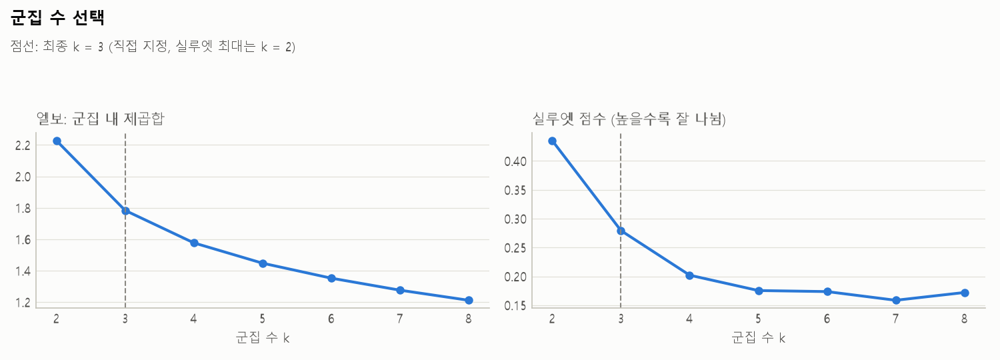
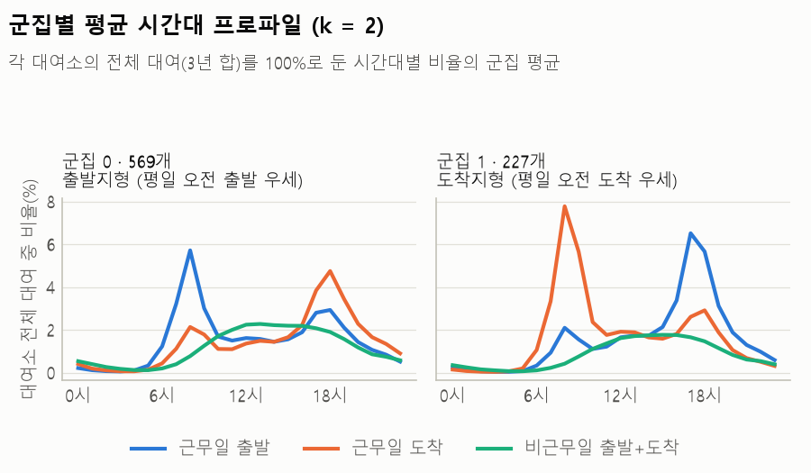
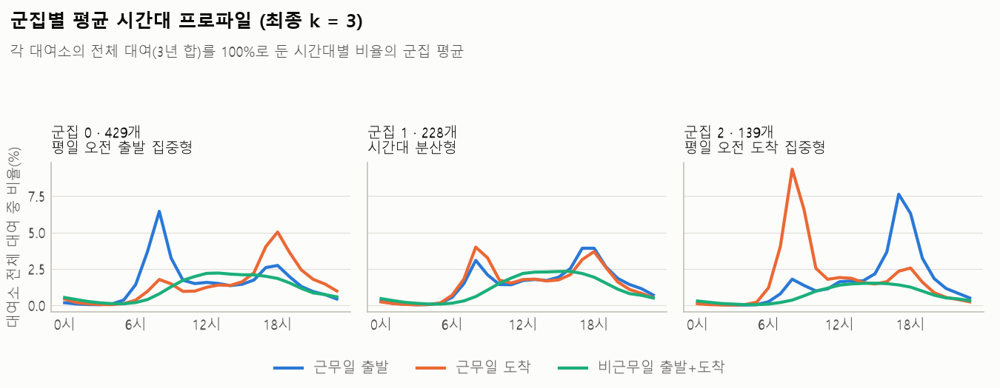
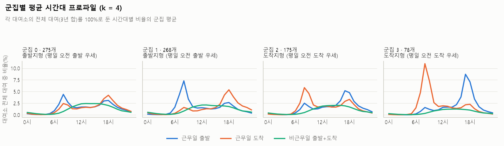
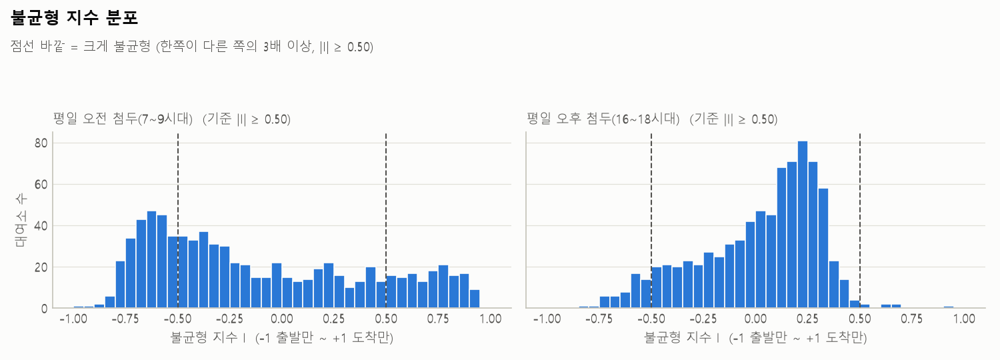
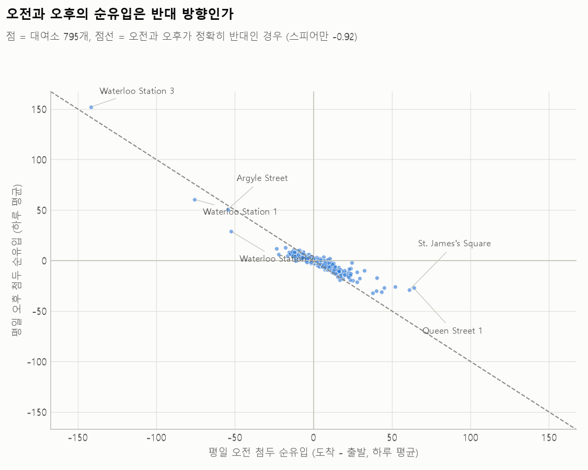
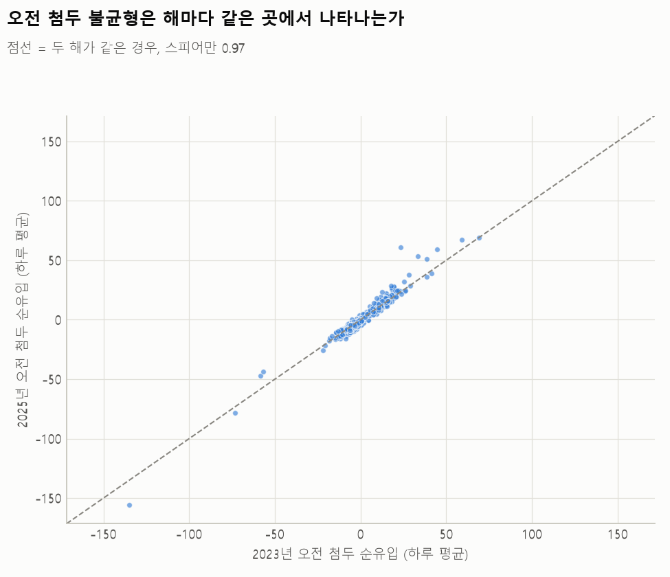
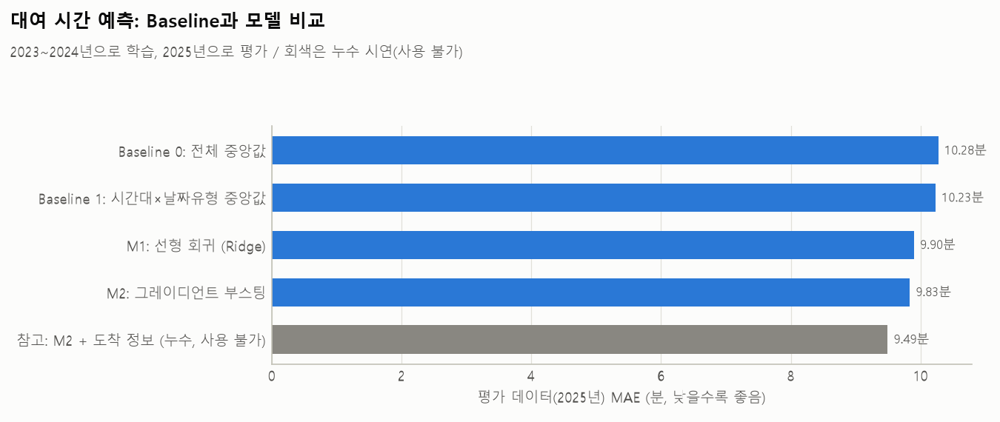
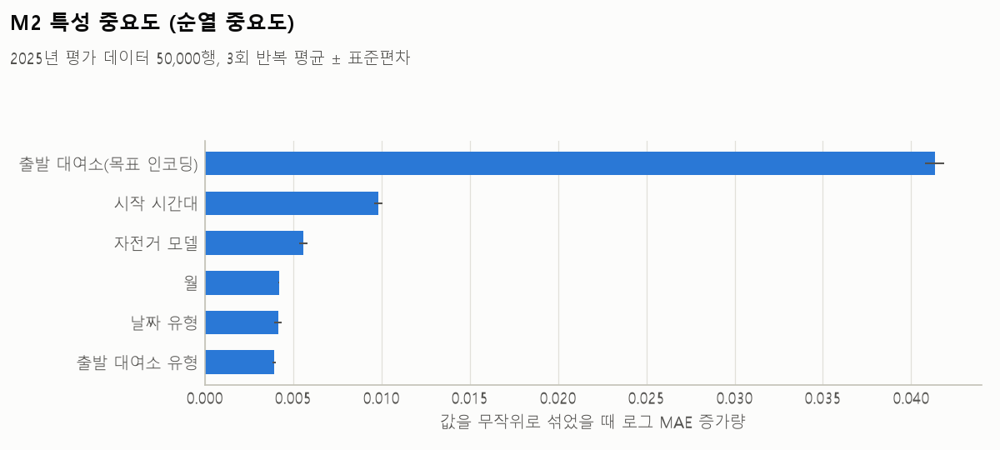
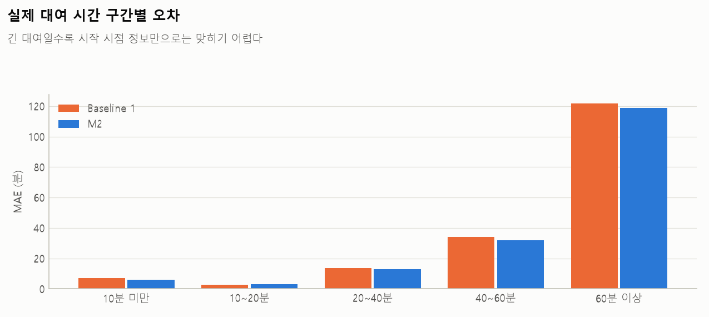

# 3차 — 본 분석·모델링·검증

혁신공유학부 배성윤 (2026-50713)

- 프로젝트: 런던 공공자전거(TfL Santander Cycles)의 시간·요일·대여소별 이용 패턴과 출발-도착 흐름 분석
- 작성일: 2026-11-23
- 관련 문서: 2차 `02_data-eda/02_data-eda.md`, 전처리 결정 기록 `docs/preprocessing_decisions.md`
- 상세 결과: `03_analysis-modeling/q1_report.md`, `q2_report.md`, `q3_report.md`, `tables_log.md`
- 표기 원칙: **관찰**(데이터에서 확인한 사실)과 **해석**(추론)을 나눈다. 외부 근거가 없는 해석은 "가설"로 표시한다.

---

## 요약

- **질문 1 (대여소 유형)**: 대여소 796개는 **평일 오전 출발 집중형 429개 / 시간대 분산형 228개 / 평일 오전 도착 집중형 139개**로 나뉜다(k = 3). 가장 뚜렷한 경계는 평일 오전의 출발·도착 방향이며(실루엣 최대 k = 2), 대여소의 94~96%가 해마다 같은 유형을 유지한다. 비근무일 이용이 많은 대여소는 k를 5까지 늘려도 별도 유형으로 갈라지지 않고 시간대 분산형 안에 섞여 있다.
- **질문 2 (불균형)**: 평일 오전 피크 시간대에는 판단 대상 795개 중 **379개(48%)**가 한쪽으로 3배 이상 치우치지만, **하루 전체로는 크게 불균형한 대여소가 0개**다. 오전과 오후 순유입의 상관은 **−0.93**이다. 불균형은 쌓이는 문제가 아니라 **시간대의 문제**이고, 같은 대여소에서 해마다 반복된다(연도 간 순위 상관 0.97~0.98).
- **질문 3 (대여 시간)**: 대여 시작 시점 정보만으로는 대여 시간을 많이 설명할 수 없다. 부스팅 모델은 가장 강한 Baseline보다 MAE를 **3.9%** 줄이는 데 그쳤다(로그 R² 0.09). 반면 전기자전거는 시간대·날짜·출발 대여소 유형이 같은 조건에서도 일반 자전거보다 **1.6~2.3분 길었고**, 그 차이는 해마다 커졌다.

---

## 1. 2차 이후 변경 사항

| 항목 | 2차 계획 | 3차 실제 | 이유 |
|---|---|---|---|
| 운영 장애일 | 날짜 단위 비교에서 제외 예정 | 모든 3차 분석에서 2025-08-05(184건) 제외 | 공급이 끊긴 날이라 이용 패턴을 대표하지 않음 |
| 질문 2 "크게 불균형" 기준 | 지수 분포를 보고 정의 (상위 몇 %) | **한쪽이 다른 쪽의 3배 이상 (\|I\| ≥ 0.5)**, 2배·4배 결과 병기 | 가짜 데이터 테스트에서 값이 같은 대여소가 많으면 '상위 10%' 기준선이 1.0으로 쏠려 출발 우세 대여소가 하나도 판정되지 않는 문제 발견. 고정 배수 기준이 뜻도 분명함 |
| 질문 2 판단 대상 | — | 시간대 하루 평균 출발+도착 3건 이상 | 3년 평일 약 750일 × 3건 = 2,000건 이상으로 지수가 안정적. 처음 정한 10건은 대여소를 너무 많이 제외 |
| 질문 1 군집 수 | 실루엣·엘보로 선택 | 실루엣(k = 2)에 더해 **k = 2~5의 군집 내용을 비교해 k = 3 선택** | k = 2의 큰 군집 안에 성격이 다른 대여소가 섞여 있음 (4.4절) |
| 질문 3 특성 | 출발 대여소 유형 포함 | 유형을 **학습 연도 자료로만 다시 군집화** | 평가 연도(2025) 정보의 누수 방지 |
| 질문 1 군집 이름 | 자동 제안 이름 (출발지형 등) | **관찰된 특성 중심 이름**: 평일 오전 출발 집중형 / 시간대 분산형 / 평일 오전 도착 집중형 | 1차 피드백: 이름은 관찰된 특성으로 붙일 것. "도심", "철도역"은 대여소 이름에서 추정한 것이라 유형 이름에서 뺌 |
| 해석 표현 | — | 목적(출퇴근·여가)은 "유사한 패턴" 또는 "가설"로, OD는 "대여소 사이 대여 건수(경로 아님)"로 표현 | 1차 피드백 ③ (관찰과 해석 구분) |

- 1차 피드백 전체의 반영 내용은 2차 문서 2절에 정리했다. 피드백이 2차에서 함께 요구한 대여소별 반납 비율·대여시간 중앙값, 대여시간 평균, 2023년 8월과의 비교, 피드백 특징 세트로 한 군집 비교는 `08_feedback_checks.py`로 추가 점검한다.

## 2. 분석 질문 최종 정리

| # | 1차 질문 | 최종 질문 |
|---|---|---|
| 1 | 시간대·요일에 따라 이용량은 어떻게 다르며, 대여소를 몇 개 유형으로 나눌 수 있는가? | 근무일·비근무일의 시간대별 출발·도착 패턴으로 대여소를 몇 가지 유형으로 나눌 수 있으며, **그 유형은 해마다 유지되는가?** (시간대·요일별 이용량 차이는 2차 EDA에서 답함) |
| 2 | 이용이 많은 흐름은 무엇이며, 출발과 도착이 크게 불균형한 대여소는 어디인가? | **시간대별로** 출발과 도착이 크게 불균형한 대여소는 어디이며, 그 불균형은 **하루 단위로 상쇄되는가, 해마다 반복되는가?** 주요 흐름은 무엇인가? |
| 3 | 1회 대여 시간은 시간대, 요일, 자전거 모델, 왕복 여부와 어떤 관련이 있는가? | 대여 **시작 시점** 정보로 1회 대여 시간을 얼마나 설명·예측할 수 있는가? 전기자전거의 긴 대여 시간은 시간·장소 구성으로 설명되는가? |

- 질문 3에서 **왕복 여부**는 대여가 끝나야 알 수 있어 예측 특성에서 뺐다. 대신 오류 분석과 누수 시연에 사용했다(6.3절, 6.5절).

## 3. 분석 방법 선정 근거

| 질문 | 방법 | 선정 근거 | 대안과 제외 이유 |
|---|---|---|---|
| 1 | 대여소별 96차원 시간대 **비율** 프로파일 + K-means | 유형을 미리 정하지 않고 데이터에서 찾는 문제라 비지도 학습이 맞다. 비율을 쓰면 규모가 아닌 '모양'을 비교할 수 있다 (1차 피드백: 이용 건수만으로 군집하면 큰 대여소와 작은 대여소로 나뉠 뿐). **표준화하지 않은 이유**: 96개 특징이 모두 같은 단위(대여소 전체 대여 중 비율, 합 = 1)라 크기를 맞출 필요가 없고, 표준화하면 이용이 거의 없는 새벽 시간대의 작은 차이가 피크 시간대와 같은 무게를 갖게 된다. **이용 적은 대여소**: 연 1,000건 미만은 비율이 우연에 흔들려 제외 | 계층적 군집: 결과가 비슷할 것으로 보고 해석이 쉬운 K-means 선택 / 단순 규칙: 비교 기준(Baseline)으로 사용 |
| 2 | 시간대별 불균형 지수 I = (도착−출발)/(도착+출발)과 하루 평균 순유입 | 지수는 대여소 규모와 무관하게 비교할 수 있고, 순유입은 실제 규모(하루 몇 대)를 보여 준다. 2차 EDA에서 오전·오후 방향이 반대였으므로 시간대별로 나눔 | 하루 합계 지수: 상쇄되어 보이지 않음 (5.3절에서 실제로 확인) |
| 3 | 로그 대여 시간 회귀: Baseline 2개 → Ridge → 그레이디언트 부스팅 | 꼬리가 긴 분포라 로그 변환. 선형 모델로 기본 관계를, 부스팅으로 비선형·상호작용을 확인. **Baseline을 이겨야** 의미가 있음 | 분류(긴 대여 여부): 기준 시간을 임의로 정해야 해서 회귀 선택 |
| 3 | 층화 비교 (같은 연도·시간대·날짜 유형·출발 대여소 유형 안에서 전기자전거 vs 일반) | 모델 중요도는 '관련 정도'만 보여 준다. 전기자전거 차이가 구성 효과인지 확인하려면 조건을 맞춘 비교가 필요 | 회귀 계수 해석: 다른 특성과의 상관 때문에 해석이 흔들릴 수 있음 |

## 4. 질문 1 — 대여소 이용 패턴 유형

### 4.1 데이터와 특성

- 대상: 2023~2025년 **매년** 출발+도착 1,000건 이상인 대여소 **796개** (전체 835개 중 39개 제외). 대상 대여소가 전체 대여의 **99.3%**를 차지한다.
- 특성: (출발/도착) × (근무일/비근무일) × 24시간 = 96개 비율 (대여소의 3년 전체 대여 = 100%)

### 4.2 군집 수



| k | 2 | 3 | 4 | 5 | 6 | 7 | 8 |
|---|---|---|---|---|---|---|---|
| 실루엣 | **0.435** | 0.279 | 0.202 | 0.175 | 0.174 | 0.159 | 0.172 |

- **관찰**: 실루엣 점수는 k = 2에서 가장 높고, k가 커질수록 낮아진다. 엘보 곡선에는 뚜렷한 꺾임이 없다.

### 4.3 k = 2 결과 (가장 뚜렷한 구분)



| 군집 | 대여소 | 이용 비중 | 하루 평균 대여(중앙값) | 비근무일/근무일 이용 비 | 오전 피크 시간대 도착 비율 | 오후 피크 시간대 도착 비율 | 이용 상위 대여소 |
|---|---:|---:|---:|---:|---:|---:|---|
| 0 | 569 | 65.7% | 48.2 | 0.86 | 0.28 | 0.59 | Hyde Park Corner, Waterloo Station 3·1, Argyle Street (Kings Cross), Albert Gate |
| 1 | 227 | 34.3% | 66.5 | 0.56 | **0.79** | 0.33 | Wormwood Street (Liverpool Street), Hop Exchange, Brushfield Street, St. James's Square, Exhibition Road |

**관찰**
- 군집 1(227개)은 평일 8시대에 **도착**이, 17시대에 **출발**이 몰린다. 오전 피크 시간대 출발+도착 중 79%가 도착이다.
- 군집 0(569개)은 반대로 평일 8시대에 출발이, 18시대에 도착이 몰리고, 비근무일 이용 비중이 상대적으로 높다.

**해석**
- 가장 뚜렷한 구분은 평일 오전의 **출발·도착 방향**이다 (출퇴근 시간대와 유사한 패턴, 이용 목적은 확인 불가). 군집 1의 이용 상위 대여소 이름은 Liverpool Street, St. James's 등 도심 지명이다 (이름에 근거한 추정, 좌표 없음).

### 4.4 k = 2의 한계: 군집 0 안의 이질성

| 군집 \ 단순 규칙 | 비근무일형 | 오전 도착형 | 오전 출발형 | 혼합형 |
|---|---:|---:|---:|---:|
| 0 | **111** | 7 | **349** | **102** |
| 1 | 9 | 203 | 0 | 15 |

- **관찰**: 군집 1은 단순 규칙의 '오전 도착형'과 거의 같다(227개 중 203개). 반면 군집 0에는 비근무일형 111개, 오전 출발형 349개, 혼합형 102개가 섞여 있다. 군집과 규칙의 ARI는 0.419다.
- **해석**: k = 2는 "도착지형 vs 그 밖"만 구분한다. 군집 0의 이용 상위에 Hyde Park(공원 이름)와 Waterloo(역 이름)가 함께 있는 것도 이 때문이다. 실루엣 점수는 가장 뚜렷한 경계를 알려 주지만, 해석에 필요한 세부 유형(비근무일 이용이 많은 유형 등)을 가릴 수 있다.

### 4.5 k 비교와 최종 선택 (k = 3)

| k | 실루엣 | 단순 규칙과의 ARI | 군집 크기 | 군집 내용 |
|---|---:|---:|---|---|
| 2 | **0.435** | 0.419 | 569 / 227 | 도착지형 vs 나머지 (나머지에 혼합·비근무일형 섞임) |
| **3** | 0.279 | **0.559** | 429 / 228 / 139 | **평일 오전 출발 집중형 / 시간대 분산형 / 평일 오전 도착 집중형** |
| 4 | 0.202 | 0.371 | 275 / 268 / 175 / 78 | 오전 출발 집중 2개(약·강) / 오전 도착 집중 2개(약·강) |
| 5 | 0.175 | 0.335 | 295 / 181 / 161 / 117 / 42 | 같은 방향을 피크 시간대 높이에 따라 더 잘게 나눔 |





**선택 근거 (k = 3)**
1. 독립적으로 정한 단순 규칙과의 일치(ARI)가 **가장 높다** (0.559).
2. 세 군집의 **시간대 모양이 서로 다르다**: 오전 출발·저녁 도착 / 양방향 모두 약한 피크 시간대와 높은 낮 시간 이용 / 오전 도착·저녁 출발이 매우 강함.
3. k = 4·5는 새로운 모양이 아니라 **같은 방향의 군집을 피크 시간대 높이에 따라 쪼갤 뿐**이다 (k = 4의 군집 0·1은 둘 다 오전 출발 집중, 군집 2·3은 둘 다 오전 도착 집중).
4. 실루엣은 k = 2보다 낮지만, k = 2는 단순 규칙의 혼합형 102개와 비근무일형 111개를 오전 출발 집중 대여소와 한 군집으로 묶는다.

**최종 3유형**

| 유형 | 대여소 | 이용 비중 | 하루 평균 대여 (중앙값) | 비근무일/근무일 이용 비 | 오전 피크 시간대 도착 비율 | 오후 피크 시간대 도착 비율 | 이용 상위 대여소 |
|---|---:|---:|---:|---:|---:|---:|---|
| 0. 평일 오전 출발 집중형 | 429 | 45.5% | 46.9 | 0.86 | **0.23** | 0.61 | Waterloo Station 3·1, Argyle Street (Kings Cross), Islington Green (Angel), London Street (Paddington) |
| 1. 시간대 분산형 | 228 | 34.5% | 64.3 | 0.79 | 0.57 | 0.47 | Hyde Park Corner, Wormwood Street (Liverpool Street), Hop Exchange, Albert Gate, Black Lion Gate |
| 2. 평일 오전 도착 집중형 | 139 | 20.0% | 62.6 | **0.46** | **0.85** | 0.28 | Brushfield Street (Liverpool Street), St. James's Square, Soho Square, Queen Street 1 (Bank), Cheapside (Bank) |

| 유형 \ 단순 규칙 | 비근무일형 | 오전 도착형 | 오전 출발형 | 혼합형 |
|---|---:|---:|---:|---:|
| 0. 평일 오전 출발 집중형 | 73 | 0 | **343** | 13 |
| 1. 시간대 분산형 | 47 | 72 | 6 | **103** |
| 2. 평일 오전 도착 집중형 | 0 | **138** | 0 | 1 |

**관찰**
- 평일 오전 도착 집중형 139개 중 138개가 단순 규칙의 '오전 도착형'이고, 비근무일 이용이 근무일의 46%에 불과하다.
- 평일 오전 출발 집중형의 이용 상위는 Waterloo·King's Cross·Paddington 등 **이름에 역이 들어간 대여소**와 Angel 같은 주거·상업 지역이다.
- 시간대 분산형에는 이름이 공원인 대여소(Hyde Park·Kensington Gardens)와 도심 주변 대여소(Liverpool Street·Borough)가 함께 있다. 단순 규칙의 비근무일형 47개와 혼합형 103개가 이 군집에 모여 있다.
- **비근무일/근무일 이용 비의 중앙값이 1 이상인 군집은 k = 2~5 어디에도 없다.** 비근무일형 120개는 k를 늘려도 독립 군집이 되지 않고 여러 군집에 흩어진다.

**해석**
- 런던 공공자전거 대여소는 **평일 오전에 출발이 몰리는지, 도착이 몰리는지, 하루에 고르게 퍼지는지**에 따라 가장 잘 나뉜다. 출퇴근 시간대와 유사한 패턴이지만, 이용 목적은 데이터로 확인할 수 없다.
- 공원처럼 쉬는 날에 많이 쓰이는 대여소도 평일에는 낮 시간대에 고르게 쓰여, 시간대 '모양'만으로는 시간대 분산형과 구분되지 않는다. 비근무일 이용이 많은 성격은 하나의 독립 유형이라기보다 **비근무일 이용 비율이라는 별도 축**으로 보는 것이 맞다 (해석). 다만 1차 피드백 특징(반납 비율·대여시간 중앙값 포함)으로 군집화하면 비근무일 이용이 근무일보다 많은 소수 군집(21개)이 갈라진다 (7.1절). 즉 '독립 유형이 되지 않는다'는 것은 **시간대 모양만 볼 때**의 결과다.
- 유형 이름은 1차 피드백에 따라 **관찰된 특성**(평일 오전 출발·도착 집중, 시간대 분산)으로 붙였고, 철도역·업무지구·공원 같은 설명은 대여소 이름에 근거한 추정이다 (좌표 없음).

### 4.6 검증

| 검증 | k = 2 (참고) | k = 3 (최종) |
|---|---|---|
| 초기값(시드) 10개 | ARI 평균 1.000, 최소 1.000 | ARI 평균 0.996, 최소 0.995 |
| 연도 안정성 (3년 중심에 각 연도 배정) | 일치율 98.1~98.7%, ARI 0.92~0.95 | 일치율 2023년 94.3%, 2024년 96.2%, 2025년 95.5% / ARI 0.843~0.896 |
| 연도별 다시 군집화 | ARI 0.918~0.949 | ARI 0.853~0.879 |
| 전처리 기준 민감도 (짧은 왕복 2분, 3시간 초과) | 일치율 100%, ARI 1.000 | 일치율 100%, ARI 1.000 |
| 단순 규칙과의 일치 | ARI 0.419 | ARI 0.559 |
| 이름 확인 (오전 피크 시간대 도착 비율 조건) | — | 평일 오전 출발 집중형 0.23 ≤ 0.4, 시간대 분산형 0.57, 평일 오전 도착 집중형 0.85 ≥ 0.7 → 일치 |

**관찰**
- k = 3도 초기값과 전처리 기준에는 거의 흔들리지 않는다 (ARI 0.995 이상, 1.000).
- 연도 안정성은 k = 2보다 조금 낮다. 해마다 대여소의 4~6%가 다른 유형으로 배정된다 (k = 2는 1~2%).

**해석**
- 군집이 하나 늘면 경계도 하나 늘어, 경계 근처의 대여소가 해마다 이쪽저쪽으로 옮겨 가는 것으로 보인다. 특히 중간 성격인 시간대 분산형과 이웃 유형 사이의 경계일 가능성이 크다 (가설: 어느 대여소가 옮겨 갔는지는 따로 확인하지 않음).
- 그래도 94% 이상이 해마다 같은 유형이므로, 세 유형은 특정 해의 우연이 아니라 **반복되는 구조**로 볼 수 있다. 가장 단단한 구조는 k = 2의 오전 출발·도착 방향이고, k = 3은 그 안에서 시간대 분산형을 구분해 해석력을 얻는 대신 안정성을 조금 내준 선택이다.

## 5. 질문 2 — 출발-도착 흐름과 불균형

### 5.1 정의

- 불균형 지수 I = (도착 − 출발) / (도착 + 출발), −1(출발만) ~ +1(도착만)
- 순유입/일 = (도착 − 출발) / 날짜 수 (하루 평균 쌓이거나(+) 빠지는(−) 자전거 수)
- 판단 대상: 해당 시간대 출발+도착 하루 평균 3건 이상
- **크게 불균형: 한쪽이 다른 쪽의 3배 이상 (|I| ≥ 0.5)**

### 5.2 시간대별 불균형



| 시간대 | 판단 대상 | 도착 우세 | 출발 우세 | \|I\| 중앙값 | 2배 이상 | 3배 이상 | 4배 이상 |
|---|---:|---:|---:|---:|---:|---:|---:|
| 평일 오전 피크 시간대 (7~9시대) | 795 | 142 | 237 | **0.483** | 543 | **379** | 268 |
| 평일 오후 피크 시간대 (16~18시대) | 805 | 7 | 53 | 0.215 | 195 | **60** | 27 |
| 평일 하루 전체 | 822 | 0 | 0 | 0.023 | 1 | **0** | 0 |
| 주말·공휴일 하루 전체 | 817 | 0 | 0 | 0.023 | 1 | **0** | 0 |

**평일 오전 피크 시간대 순유입 상위** (하루 평균)

| 출발 우세 | 순유입/일 | I | 도착 우세 | 순유입/일 | I |
|---|---:|---:|---|---:|---:|
| Waterloo Station 3 | −141.7 | −0.95 | Queen Street 1, Bank | +63.9 | 0.73 |
| Waterloo Station 1 | −75.9 | −0.72 | St. James's Square | +61.1 | 0.82 |
| Argyle Street, Kings Cross | −54.4 | −0.69 | Holborn Circus | +52.1 | 0.82 |
| Waterloo Station 2 | −52.6 | −0.95 | Moorfields, Moorgate | +45.1 | 0.67 |
| Boston Place, Marylebone | −23.6 | −0.53 | Queen Street 2, Bank | +43.3 | 0.74 |

**관찰**
- 평일 오전 피크 시간대에는 판단 대상의 48%(379개)가 크게 불균형하다. 오후 피크 시간대는 7%(60개)이고, 지수 중앙값도 오전(0.483)이 오후(0.215)의 두 배가 넘는다.
- 하루 전체로 보면 크게 불균형한 대여소가 **평일·주말 모두 0개**다.
- 2배·4배 기준으로 바꾸면 개수는 달라지지만 "오전 ≫ 오후 ≫ 하루 전체(거의 0)"라는 순서는 같다.

**해석**
- 오전 이동은 같은 시간대에 같은 방향(역 이름의 대여소 → 도심 대여소)으로 몰리는 반면, 오후 이동은 퇴근 뒤 다른 곳에 들르는 등 목적과 시간이 흩어지는 것으로 보인다 (가설). 오후 피크 시간대 이후인 19시대에도 이용이 많다는 EDA 관찰과도 맞는다.

### 5.3 오전·오후 상쇄



- **관찰**: 오전·오후 모두 판단 대상인 795개 대여소에서 오전 순유입과 오후 순유입의 상관은 **피어슨 −0.929, 스피어만 −0.919**다. Waterloo Station 3은 오전 −141.7대, 오후 +152.1대다.
- **관찰**: 오전에 크게 불균형한 379개 대여소의 평일 하루 전체 |I| 중앙값은 **0.035**이고, **85%(321개)**가 |I| < 0.1이다.
- **해석**: 출퇴근 왕복이 같은 대여소 쌍을 반대 방향으로 오가므로, 불균형은 하루가 지나면 거의 사라진다. 불균형은 **"하루 동안 쌓이는 문제"가 아니라 "특정 시간대에 몰리는 문제"**다. 하루 합계만 보면 이 현상을 놓친다는 점이 시간대별로 정의한 근거다.

### 5.4 주요 흐름

| 평일 오전 피크 시간대 흐름 | 평일 하루 평균 | 평일 오후 피크 시간대 흐름 | 평일 하루 평균 |
|---|---:|---|---:|
| Ackroyd Drive, Bow → Maplin Street, Mile End | 5.5 | Newgate Street, St. Paul's → Waterloo Station 3 | 4.9 |
| Monier Road, Hackney Wick → Stratford Station | 3.5 | Wormwood Street, Liverpool Street → Waterloo Station 3 | 3.9 |
| Waterloo Station 3 → Cheapside, Bank | 3.3 | Cheapside, Bank → Waterloo Station 3 | 3.7 |
| Waterloo Station 3 → Newgate Street, St. Paul's | 3.3 | Maplin Street, Mile End → Ackroyd Drive, Bow | 3.5 |
| Waterloo Station 3 → Queen Street 1, Bank | 3.3 | Queen Street 1, Bank → Waterloo Station 3 | 3.0 |

**관찰**
- 위 표는 출발 대여소와 도착 대여소 사이의 **대여 건수**다. 실제 주행 경로는 데이터에 없다. OD 집계 합계는 전체 대여 건수와 같다 (2차 `eda_report.md` 0절).
- Waterloo Station 3의 오전 피크 시간대 출발은 **573곳**으로 흩어지고, 가장 많은 도착지(Cheapside, Bank)도 2.3%에 그친다.
- 오전 상위 흐름에는 `Hackney Wick → Stratford Station`, `Rainville Road → Barons Court Station`, `Stainsby Road → Westferry DLR`처럼 **역 이름이 붙은 대여소로 향하는 흐름**도 있다.

**해석**
- 철도역 대여소의 불균형은 몇 개 경로가 아니라 **한 곳에서 수백 곳으로 퍼지는 흐름**의 합이다. 특정 경로를 관리하는 방식으로는 다루기 어렵다.
- 도심 바깥에서는 집에서 역까지 자전거를 타고 가는 이동(대중교통 연계)도 보인다 (이름에 근거한 가설).
- `Bow → Mile End`가 3년 내내 가장 많은 단일 흐름인 이유는 확인하지 못했다.

### 5.5 검증

| 검증 | 결과 |
|---|---|
| 연도 일관성 (오전 피크 시간대 순유입 순위 상관) | 2023 vs 2024 **0.982**, 2024 vs 2025 **0.982** / 상위 10개 겹침 도착 9/10, 출발 7~8/10 |
| 연도 일관성 (오후 피크 시간대) | 0.966, 0.970 / 상위 10개 겹침 8~9/10 |
| 전처리 기준 민감도 | 순위 상관 1.000, 상위 10개 10/10 겹침 (두 변형 모두) |
| 기준 배수 민감도 | 2배·3배·4배 모두 같은 결론 (5.2절) |
| 질문 1 유형과 연결 | 아래 표 |

**질문 1 유형별 오전 피크 시간대 판정 (대여소 수)**

| 유형 | 출발 우세 | 도착 우세 | 균형~보통 | 이용 적음(판단 제외) |
|---|---:|---:|---:|---:|
| 0. 평일 오전 출발 집중형 | **234** | 0 | 187 | 8 |
| 1. 시간대 분산형 | 1 | 27 | 193 | 7 |
| 2. 평일 오전 도착 집중형 | 0 | **111** | 28 | 0 |



**관찰**
- 오전 피크 시간대 출발 우세 대여소 237개 중 234개(98.7%)가 평일 오전 출발 집중형, 도착 우세 142개 중 111개(78%)가 평일 오전 도착 집중형이다.
- 시간대 분산형 228개 중 193개(85%)는 오전 피크 시간대에도 균형~보통이다.

**해석**
- 불균형은 특정 해의 우연이 아니라 **같은 대여소에서 해마다 반복되는 구조**다.
- 질문 1의 유형과 질문 2의 판정이 잘 맞는 것은 **독립적인 검증이 아니라 일관성 확인**이다. 두 분석 모두 같은 근무일 오전 출발·도착 자료를 쓰므로 어느 정도 일치하는 것이 당연하다. 이 표에서 의미 있는 점은 "시간대 분산형은 피크 시간대에도 대부분 균형"이라는, 유형 이름과 실제 불균형이 맞는다는 확인이다.

## 6. 질문 3 — 1회 대여 시간

### 6.1 설계 (Feature / Target / Train·Test)

| 항목 | 내용 |
|---|---|
| 데이터 | 분석 데이터의 5% 표본 1,306,209행 (trip_id 기준 추출, 재현 가능) |
| Target | log(대여 시간[분]). 평가는 분 단위로 되돌려 계산 |
| Feature | 시작 시간대, 날짜 유형(평일/주말/공휴일), 월, 자전거 모델, 출발 대여소 유형, 출발 대여소 목표 인코딩 |
| Train / Test | **2023~2024년 856,495행 학습 / 2025년 449,714행 평가** (시간 순서 분할: 과거로 미래를 예측) |
| Baseline | B0: 전체 중앙값 / B1: 시작 시간대 × 날짜 유형별 중앙값 |
| 모델 | M1: Ridge 선형 회귀 / M2: 그레이디언트 부스팅 (HistGradientBoosting) |
| 지표 | MAE(분), 오차 중앙값(분), 로그 MAE, 로그 R² |

### 6.2 Data Leakage 점검

| 위험 | 조치 |
|---|---|
| 대여가 끝나야 알 수 있는 정보 (도착 대여소, 왕복 여부, 종료 시각) | 특성에서 **제외**. 넣으면 성능이 얼마나 부풀려지는지 별도로 시연 (6.3절) |
| 출발 대여소 목표 인코딩에 자기 자신의 대여 시간이 섞임 | 학습 데이터는 **5겹 out-of-fold**로 계산, 평가 데이터에는 학습 데이터 통계만 사용 |
| 출발 대여소 유형에 평가 연도 정보가 섞임 | 유형을 **2023~2024년 이용 자료만으로** 다시 군집화 |
| 무작위 분할 시 같은 기간의 비슷한 대여가 학습·평가에 함께 들어감 | **연도 기준 분할** |
| 학습에 없는 연도의 외삽 | 연도를 특성에서 제외 |

### 6.3 Baseline과 모델 비교



| 모델 | MAE(분) | 오차 중앙값(분) | 로그 MAE | 로그 R² |
|---|---:|---:|---:|---:|
| B0: 전체 중앙값 | 10.277 | 6.348 | 0.611 | −0.001 |
| B1: 시간대 × 날짜 유형 중앙값 | 10.233 | 6.314 | 0.607 | 0.009 |
| M1: Ridge | 9.898 | 5.875 | 0.584 | 0.080 |
| **M2: 그레이디언트 부스팅** | **9.833** | **5.802** | **0.579** | **0.090** |
| 참고: M2 + 도착 정보 (누수, 사용 불가) | 9.492 | 5.459 | 0.553 | 0.158 |

- **관찰**: M2는 B1보다 MAE를 **3.9%** 줄였다 (10.23분 → 9.83분). 로그 R²는 0.090이다.
- **관찰**: 학습과 평가 지표가 거의 같아 과적합은 보이지 않는다 (M2 학습 MAE 9.74분, 평가 9.83분).
- **관찰**: 도착 정보를 넣으면 MAE가 3.5% 더 줄고 로그 R²가 0.158로 오른다. 대여 시작 시점에는 알 수 없는 정보이므로 사용하지 않는다.
- **해석**: 대여 시작 시점의 정보로는 대여 시간의 변동 중 약 9%만 설명된다. 대여 시간은 **어디로, 왜 가는지**에 크게 좌우되는데 그 정보는 시작 시점에 없다. "예측이 잘 안 된다"는 것 자체가 이 질문의 결과다.

**전처리 기준 민감도** (기준을 바꾼 데이터로 다시 학습·평가)

| 기준 | 평가 행 수 | B1 MAE(분) | M2 MAE(분) | B1 대비 변화 |
|---|---:|---:|---:|---:|
| 현재 기준 | 449,714 | 10.233 | 9.833 | −3.9% |
| 짧은 왕복 2분 이하 추가 제외 | 448,926 | 10.230 | 9.825 | −4.0% |
| 3시간 초과 추가 제외 | 448,576 | 9.192 | 8.796 | −4.3% |

- **관찰**: 3시간 초과를 빼면 긴 꼬리가 줄어 두 모델의 MAE가 모두 약 1분 작아지지만, B1 대비 개선 폭은 3.9~4.3%로 거의 같다.
- **해석**: "모델이 Baseline보다 조금(약 4%) 낫다"는 결론은 전처리 기준에 흔들리지 않는다.

### 6.4 특성 중요도



| 특성 | 로그 MAE 증가 (값을 섞었을 때) |
|---|---:|
| 출발 대여소 (목표 인코딩) | 0.0413 |
| 시작 시간대 | 0.0098 |
| 자전거 모델 | 0.0056 |
| 월 | 0.0042 |
| 날짜 유형 | 0.0041 |
| 출발 대여소 유형 | 0.0039 |

- **관찰**: 출발 대여소가 다른 특성보다 4배 이상 중요하다.
- **해석**: 같은 시간대라도 **어디서 출발하는지**가 대여 시간을 가장 잘 구분한다. 대여소마다 주변 목적지와의 거리, 비근무일 이용 비중, 피크 시간대 집중 정도가 다르기 때문으로 보인다 (가설).

### 6.5 오류 분석 (M2, 2025년)



| 실제 대여 시간 | 건수 | M2 MAE(분) | B1 MAE(분) | 평균 편향(예측 − 실제) |
|---|---:|---:|---:|---:|
| 10분 미만 | 159,242 | 6.09 | 6.93 | +6.07 |
| 10~20분 | 161,111 | 3.27 | 2.66 | −1.22 |
| 20~40분 | 102,048 | 12.86 | 13.65 | −12.74 |
| 40~60분 | 18,819 | 32.04 | 34.14 | −32.04 |
| 60분 이상 | 8,494 | 118.92 | 121.71 | −118.92 |

| 구분 | M2 MAE(분) | B1 MAE(분) |
|---|---:|---:|
| 편도 | 9.37 | 9.73 |
| **왕복** (특성으로 쓰지 않음) | **26.98** | 28.99 |
| 평일 / 주말 / 공휴일 | 9.00 / 12.23 / 14.77 | 9.33 / 12.82 / 15.77 |
| 일반 자전거 / 전기자전거 | 9.87 / 9.68 | 10.29 / 9.98 |

**관찰**
- 모델은 짧은 대여는 길게, 긴 대여는 짧게 예측한다. 예측이 중앙값 근처로 모이는 경향이다.
- 60분 이상 대여는 평균 119분 짧게 예측했다. 10~20분 구간에서만 B1이 M2보다 낫다.
- 왕복 대여의 오차는 편도의 약 3배다.

**해석**
- 왕복(출발한 대여소에 반납)과 긴 대여는 시작 시점 정보로 구분되지 않는다. 중간에 어디를 들렀는지, 목적이 무엇인지(여가 등)는 데이터로 확인할 수 없다. 이 오차는 모델의 결함이라기보다 **입력 정보의 한계**를 보여 준다.

### 6.6 관련성: 전기자전거는 같은 조건에서도 더 오래 타는가

| 연도 | 단순 중앙값 차이 | 층화 후 차이 (가중 평균) | 전기자전거가 더 긴 층 비율 | 비교한 층 수 |
|---|---:|---:|---:|---:|
| 2023 | +1.43분 | **+1.59분** | 81% | 124 |
| 2024 | +1.94분 | **+2.08분** | 90% | 137 |
| 2025 | +2.22분 | **+2.30분** | 87% | 166 |

- 층 = 같은 연도 × 시작 시간대 × 날짜 유형 × 출발 대여소 유형 (두 모델 모두 20건 이상인 층만)
- **관찰**: 조건을 맞춰도 차이가 줄지 않고(오히려 조금 커짐), 81~90%의 층에서 전기자전거가 더 길다. 차이는 해마다 커졌다.
- **관찰**: 대여소 유형을 k = 2에서 k = 3으로 바꿔 층을 더 잘게 나눠도 결과가 거의 같았다 (k = 2: +1.59 / +2.07 / +2.34분).
- **해석**: 전기자전거가 긴 것은 특정 시간대·장소에 몰려서 생긴 **구성 효과가 아니다**. 더 먼 거리를 가는 데 쓰일 가능성이 있지만, 이 데이터에는 거리·좌표가 없어 원인을 확인할 수 없다 (가설).

## 7. 결과 검증 요약

| 질문 | 검증 | 결과 |
|---|---|---|
| 공통 | 분석 테이블 검산 | 분석 행 26,126,791 = 읽은 행 − 장애일 = 표의 출발 합계 = 도착 합계 |
| 공통 | 정답을 아는 가짜 데이터로 스크립트 검증 | 심어 둔 유형(주거·업무·공원), 불균형 방향, 대여 시간 효과를 모두 복원 |
| 1 | 시드 / 연도 / 전처리 기준 / 단순 규칙 | k = 3: ARI 0.996 / 0.84~0.90 (일치율 94~96%) / 1.000 / 0.559 (참고 k = 2: 1.000 / 0.92~0.95 / 1.000 / 0.419) |
| 1 | 2023년 8월 자료 / 다른 특징 세트 | 유형 일치 90.4% (ARI 0.730) / 실루엣 최대 k = 3, ARI 0.56 |
| 2 | 연도 / 전처리 기준 / 기준 배수 | 순위 상관 0.97~0.98 / 1.000 / 같은 결론 |
| 3 | 시간 순서 분할, 과적합 확인, 누수 시연, 전처리 기준 | 학습 ≈ 평가 (9.74 vs 9.83분), 누수 시 3.5% 부풀려짐, 기준을 바꿔도 B1 대비 −3.9~−4.3% |

### 7.1 1차 피드백 추가 점검 (`08_feedback_checks.py` → `feedback_checks.md`)

| 피드백 요구 | 점검 방법 | 결과 |
|---|---|---|
| 대여시간 평균과 중앙값을 함께 확인 | 전체·평일/주말·편도/왕복·연도×자전거 종류별 평균, 중앙값, 평균÷중앙값 | 전체 평균 17.98분 / 중앙값 13.2분 (1.36배). 주말·공휴일 1.46배, 왕복 39.9분 / 27.2분. 평균이 긴 대여에 끌려가므로 중앙값 중심 서술과 질문 3의 log 변환이 맞다. 중앙값은 전기자전거가 일반 자전거보다 1.4~2.2분 길다 |
| 대여소별 반납 비율·대여시간 중앙값 | 대여소 요약표 `data/agg/station_summary.csv` (출발·도착·차이, 평일·주말 일평균, 동일 대여소 반납 비율, 대여시간 중앙값·평균) | 반납 비율 중앙값 2.0% (90% 지점 4.6%), 대여시간 중앙값 12.85분. 상위는 Hyde Park·Queen Elizabeth Olympic Park 이름의 대여소 (반납 비율 20~38%, 대여시간 중앙값 24~26분) |
| OD 집계가 출발·도착 합계와 맞는지 | OD 행렬 합계 = 출발 합계 = 도착 합계 | **일치** (26,126,975건 = 분석 행 + 장애일 184건, EDA 집계 기준) |
| 분석 범위를 "2023년 8월"로 명확히 (다른 월은 확장 과제) | 8월만 본 시간대 모양·오전 피크 시간대 불균형 순위·질문 1 유형 배정을 3년 결과와 비교 | 시간대 모양 상관 평일 0.992 / 주말·공휴일 0.995. 오전 피크 시간대 순유입 순위 상관 0.972, 상위 10개 겹침 8/10·8/10, 1위 대여소 동일. 질문 1 유형 일치 90.4% (ARI 0.730). 단 8월 평일은 오전 피크 시간대 비중이 낮다 (22.5% vs 24.9%, 1위 시간대 18시대) → 여름휴가철 영향으로 보이며, 한 달만 쓰면 평일 오전 집중이 약하게 나온다 |
| 피드백 특징 세트로 군집화 (표준화) | 이용량(log)·도착 비중·출발/도착 차이·반납 비율·대여시간 중앙값(log)을 표준화해 K-means, 질문 1 유형과 ARI·교차표 비교 | 실루엣 최대도 k = 3 (0.325, 낮아서 경계가 뚜렷하지는 않음). 질문 1 유형과 ARI 0.56. 두 군집(505·270개)은 오전 출발 집중 / 오전 도착 집중 축으로 질문 1과 같은 방향으로 갈리고, **세 번째 군집 21개**는 반납 비율(+4.8 표준편차)과 대여시간 중앙값(+2.6)이 높고 비근무일/근무일 비 1.53이다. 이 21개는 질문 1에서 시간대 분산형 14개, 오전 출발 집중형 7개로 나뉘어 있었다 |

- **결론 1 — 3년 범위 유지**: 2023년 8월만 보아도 주요 결론(시간대 모양, 불균형이 큰 대여소, 대여소 유형)은 같다. 3년은 연도별 안정성 검증과 질문 3의 시간 순서 분할을 가능하게 하고, 8월만 쓰면 여름 영향으로 평일 오전 집중이 약하게 나온다.
- **결론 2 — 질문 1의 k = 3 유지, 해석 보완**: 다른 특징 세트로도 k = 3이 가장 나았고, 주된 구분 축(평일 오전 출발 vs 도착)도 같다. 다만 반납 비율과 대여시간을 넣으면 **"출발한 대여소에 반납하고 오래 타는" 소수 대여소(21개, 2.6%)**가 따로 드러난다. 시간대 모양만 쓰는 질문 1에서는 보이지 않던 축이므로, 질문 1의 3개 유형에 이 21개를 **보조 표시**로 덧붙여 해석한다 (유형을 4개로 늘리지 않음: 시간대 모양 군집에서는 k = 4~5에서도 이런 군집이 생기지 않았다, 4.5절).

## 8. 결과 해석 및 한계

**종합 해석**
1. 런던 공공자전거의 대여소는 **평일 오전의 출발·도착 집중 정도**(평일 오전 출발 집중형 / 시간대 분산형 / 평일 오전 도착 집중형)로 가장 잘 나뉘고, 대여소의 94~96%가 3년 내내 같은 유형을 유지했다. 비근무일 이용이 많은 성격은 시간대 모양으로는 갈라지지 않고, 반납 비율·대여시간을 함께 볼 때 소수 대여소(21개)로 드러났다 (7.1절). 2023년 8월만 보아도 같은 결론이다 (유형 일치 90.4%).
2. 불균형은 **시간대에 몰리는 현상**이다. 하루 단위로는 거의 상쇄되므로, 운영 관점의 논의는 하루 합계가 아니라 피크 시간대 시간대 기준이어야 한다 (해석, 재고 자료 없음).
3. 대여 시간은 시작 시점 정보로 거의 예측되지 않는다. 다만 전기자전거가 같은 조건에서도 더 오래 쓰인다는 차이는 뚜렷하고 커지고 있다.

**한계**
- **좌표가 없다**: 대여소 주변 환경(역, 업무지구, 공원)과 이동 거리는 이름으로만 추정했다.
- **재고·재배치 기록이 없다**: 불균형이 실제 자전거 부족·반납 불가로 이어졌는지, TfL의 재배치로 해소됐는지 알 수 없다.
- **이용자 정보가 없다**: "통근", "여가"는 시간·장소 패턴에서 추론한 해석이다.
- **날씨 자료가 없다**: 질문 3 모델에 날씨를 넣으면 설명력이 오를 수 있다 (추가 확인 사항).
- **질문 1 특성 설계의 영향**: 프로파일을 대여소의 전체 대여(근무일이 약 3분의 2) 대비 비율로 만들어 근무일 모양이 크게 반영된다. 피드백 특징 세트로 확인한 결과, 반납 비율·대여시간을 넣으면 비근무일 이용이 많은 소수 군집(21개)이 갈라졌다 (7.1절). 근무일·비근무일을 따로 정규화한 프로파일은 확인하지 않았다.
- **군집 수는 판단이다**: 시간대 프로파일의 실루엣은 k = 2를 가리켰고, k = 3은 해석 가능성과 단순 규칙과의 일치를 근거로 골랐다. 이후 다른 특징 세트의 실루엣 최대가 k = 3이고, 2023년 8월 자료로도 90.4%가 같은 유형에 배정되어 선택을 뒷받침한다. 그래도 k = 3은 '대여소의 진짜 유형 수'가 아니라 **이 특성으로 본 가장 설명하기 좋은 구분**이다.
- **질문 3은 5% 표본**이다. trip_id 기준으로 뽑아 연도별 비중은 고르지만, 전체 데이터로 학습하면 수치가 조금 다를 수 있다.
- **일반화 범위**: 2023~2025년 런던 TfL 공공자전거(도크형)에 한정된다.

## 9. 생성형 AI 결과 검증 과정

| # | AI 결과물 | 검증 방법 | 발견 → 수정 |
|---|---|---|---|
| 13 | 질문 1의 "실루엣 최대 k 자동 선택" | 군집 요약과 단순 규칙 교차표를 직접 읽음 | k = 2의 큰 군집에 단순 규칙의 혼합형·비근무일형·오전 출발형이 섞임 → k = 2~5 내용 비교를 추가해 k = 3을 근거와 함께 선택 |
| 13-1 | 질문 1의 자동 군집 이름 | k = 3 프로파일 그래프와 이름 비교 | 오전 도착 비율 0.57인 군집이 경계값(0.55) 때문에 "도착지형"으로 이름 붙음 → 그래프를 보고 직접 지정했고, 1차 피드백에 따라 관찰된 특성 중심 이름(평일 오전 출발 집중형 / 시간대 분산형 / 평일 오전 도착 집중형)으로 최종 확정. 이름이 지표와 어긋나면 경고하는 확인 장치 추가 (가짜 데이터로 경고가 나는 것 확인) |
| 14 | 질문 2의 "지수 상위 10%" 기준 | 정답을 아는 가짜 데이터로 실행 | 동점이 많으면 기준선이 1.0으로 쏠려 출발 우세 0개 → '3배 이상' 고정 기준 + 2배·4배 병기로 변경 |
| 15 | 질문 2의 순위표 | 가짜 데이터 결과를 읽음 | 출발 우세 대여소가 없을 때 "출발 상위 10" 표에 도착 우세 대여소가 채워짐 → 방향이 맞는 대여소만 표시 |
| 16 | 질문 2의 판단 대상 기준(하루 10건) | 3년 평일 수로 건수를 계산 | 3건이면 2,000건 이상으로 충분, 10건은 과도한 제외 → 3건으로 완화 |
| 17 | 질문 3의 누수 위험 | 특성마다 "대여 시작 시점에 알 수 있는가" 점검 | 도착 정보 제외, 목표 인코딩 OOF, 유형을 학습 연도로만 재군집화, 누수 시연으로 영향 측정 |
| 18 | 질문 3 보고서의 고정 문장 | 가짜 데이터 결과(누수 시 개선 0.1%)와 문장 비교 | "부풀려진다"는 단정 → 실제 수치에 따라 문장이 바뀌도록 수정 |
| 19 | 3차 그래프 | 그래프를 직접 열어 확인 | 제목·부제목 겹침, 범례가 선을 가림, 이름표 겹침 → 배치 수정 |

(1~12번 사례는 `docs/preprocessing_decisions.md` 6절)

## 10. 최종 보고서 계획 (3차 최종 보고서, 12월 6일 제출)

- 과목 일정 변경: 2차 발표는 중간 보고서(11월 29일)로 대체되고, 최종 보고서는 3차(12월 6일, 본문 15쪽 이내)로 제출한다. 이 문서의 '3차'는 원래 단계 이름(본 분석·모델링·검증)을 뜻한다.
- 최종 보고서 `04_final/`: 문제 정의 → 데이터·전처리 → 분석 방법 → 결과와 해석 → 검증 과정 → LLM 활용·검증 → 문제와 해결 → 한계·개선 방향 → 결론
- 핵심 결과 재현 Notebook: 집계 테이블에서 주요 수치·그래프를 다시 계산해 검증
- (선택) Streamlit 앱 (`app/`): `data/agg/` 집계 테이블로 대여소 유형, 시간대별 불균형, 모델 비교를 탐색. 분석 내용과 검증을 중심으로 구성
- README: 실행 순서(00 → 08), 필요 패키지, 데이터 내려받기 방법(https://cycling.data.tfl.gov.uk/#!usage-stats%2F), 이용 조건

## 재현 방법

```
python 04_build_analysis_tables.py   # 분석용 테이블·질문 3 표본 (2,600만 행을 한 번 읽음)
python 05_q1_station_types.py        # 질문 1
python 06_q2_imbalance.py            # 질문 2 (질문 1 결과 사용)
python 07_q3_duration_model.py       # 질문 3 (질문 1의 k 사용)
python 08_feedback_checks.py         # 1차 피드백 추가 점검 (질문 1 결과 사용, 원자료를 한 번 더 읽음)
```

- 필요 패키지: pandas, pyarrow, matplotlib, scikit-learn, tabulate
- `common.py`에 경로·공휴일·장애일·그래프 스타일·프로파일 계산을 모았다.

---

Powered by TfL Open Data. 이 프로젝트는 TfL과 관련이 없으며 TfL의 보증을 받지 않았다.