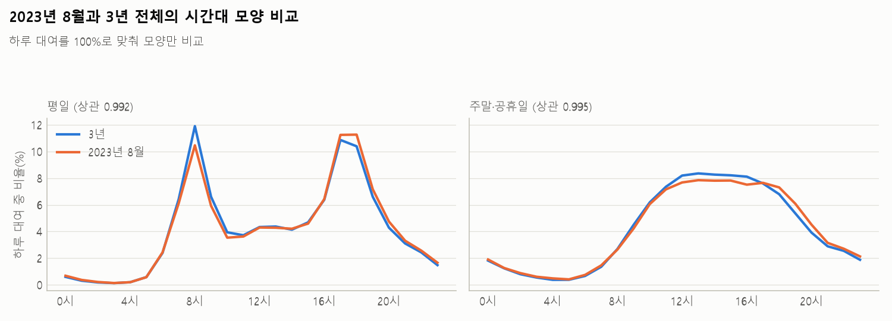
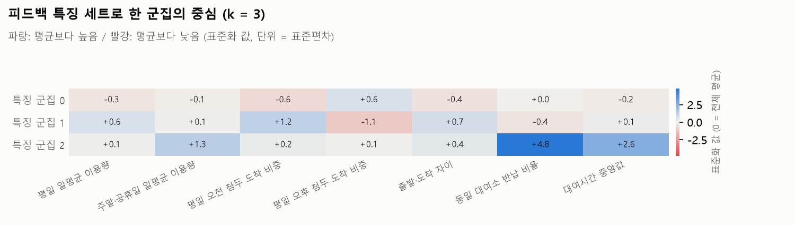

# 1차 피드백 추가 점검

- 실행 일시: 2026-11-26 17:49
- 분석 행: 26,126,791 (운영 장애일 184건 제외)
- 1차 피드백에서 요구했지만 2·3차에서 계산하지 않은 항목을 점검한다. 이 보고서는 **관찰(수치)**을 기록한다.

## 1. 대여시간의 평균과 중앙값

평균은 원자료에서 정확히 계산했고, 중앙값은 0.1분 간격 히스토그램(`03_eda.py`)의 구간 중앙값이다 (히스토그램에는 장애일 184건이 포함되어 건수가 조금 다르지만 중앙값에는 사실상 영향이 없다).

| 구분               |      대여 건수 |   평균(분) |   중앙값(분) |   평균 ÷ 중앙값 |
|:-----------------|-----------:|--------:|---------:|-----------:|
| 전체               | 26,126,791 |   17.98 |     13.2 |       1.36 |
| 평일               | 19,522,794 |   16.81 |     12.8 |       1.31 |
| 주말·공휴일           |  6,603,997 |   21.44 |     14.6 |       1.46 |
| 편도               | 25,364,446 |   17.32 |     13   |       1.33 |
| 왕복 (출발한 대여소에 반납) |    762,345 |   39.91 |     27.2 |       1.46 |
| 2023년 CLASSIC    |  7,839,198 |   18.36 |     13   |       1.41 |
| 2023년 PBSC_EBIKE |    613,614 |   18.54 |     14.4 |       1.28 |
| 2024년 CLASSIC    |  7,697,657 |   17.35 |     13   |       1.34 |
| 2024년 PBSC_EBIKE |    983,852 |   18.87 |     14.8 |       1.27 |
| 2025년 CLASSIC    |  7,369,087 |   17.73 |     13   |       1.37 |
| 2025년 PBSC_EBIKE |  1,623,383 |   19.51 |     15.2 |       1.28 |

- 평균 ÷ 중앙값이 1보다 크면 긴 대여(오른쪽 꼬리)가 평균을 끌어올린 것이다.

## 2. 대여소별 요약표와 OD 검산

- 전체 대여소 835개의 요약표: `data/agg/station_summary.csv`
- 열: 출발·도착 건수, 차이(도착 − 출발), 평일·주말·공휴일 일평균, 비근무일/근무일 비, 오전·오후 첨두 도착 비중, 동일 대여소 반납 비율, 대여시간 중앙값·평균, 분석 대상 여부(연 1,000건 이상), 질문 1 유형

분석 대상 대여소 796개의 분포:

|               |    10% |    중앙값 |     90% |
|:--------------|-------:|-------:|--------:|
| 동일 대여소 반납 비율  |  0.01  |  0.02  |   0.046 |
| 대여시간 중앙값(분)   | 10.45  | 12.85  |  17.25  |
| 평일 일평균 이용     | 26.305 | 56.323 | 105.966 |
| 주말·공휴일 일평균 이용 | 20.065 | 41.95  |  79.596 |

동일 대여소 반납 비율 상위 8개 대여소:

| 대여소                                               |   동일 대여소 반납 비율 |   비근무일/근무일 비 | 질문 1 유형      |
|:--------------------------------------------------|---------------:|-------------:|:-------------|
| Podium, Queen Elizabeth Olympic Park              |          0.382 |        1.329 | 시간대 분산형      |
| Hyde Park Corner, Hyde Park                       |          0.286 |        1.628 | 시간대 분산형      |
| Timber Lodge, Queen Elizabeth Olympic Park        |          0.283 |        1.696 | 평일 오전 출발 집중형 |
| Triangle Car Park, Hyde Park                      |          0.247 |        1.865 | 시간대 분산형      |
| Lee Valley VeloPark, Queen Elizabeth Olympic Park |          0.23  |        1.692 | 평일 오전 출발 집중형 |
| Park Lane, Hyde Park                              |          0.209 |        1.613 | 시간대 분산형      |
| South Quay East, Canary Wharf                     |          0.207 |        1.237 | 시간대 분산형      |
| Black Lion Gate, Kensington Gardens               |          0.203 |        1.579 | 시간대 분산형      |

대여시간 중앙값 상위 8개 대여소:

| 대여소                                        |   대여시간 중앙값 |   비근무일/근무일 비 | 질문 1 유형      |
|:-------------------------------------------|-----------:|-------------:|:-------------|
| Hyde Park Corner, Hyde Park                |      26.35 |        1.628 | 시간대 분산형      |
| Park Lane, Hyde Park                       |      26.35 |        1.613 | 시간대 분산형      |
| Podium, Queen Elizabeth Olympic Park       |      25.25 |        1.329 | 시간대 분산형      |
| Timber Lodge, Queen Elizabeth Olympic Park |      25.15 |        1.696 | 평일 오전 출발 집중형 |
| Triangle Car Park, Hyde Park               |      24.95 |        1.865 | 시간대 분산형      |
| Saunders Ness Road, Cubitt Town            |      24.85 |        2.05  | 평일 오전 출발 집중형 |
| Knightsbridge, Hyde Park                   |      24.35 |        1.529 | 시간대 분산형      |
| Albert Gate, Hyde Park                     |      23.85 |        1.44  | 시간대 분산형      |

OD 검산 (03_eda.py 집계):

| 항목        |         건수 |
|:----------|-----------:|
| OD 집계 합계  | 26,126,975 |
| 대여소 출발 합계 | 26,126,975 |
| 대여소 도착 합계 | 26,126,975 |

- 결과: **일치** (OD 행렬의 모든 칸을 더한 값 = 출발 합계 = 도착 합계)

## 3. 2023년 8월만 본 결과 vs 3년 결과

1차 피드백은 한 달 자료로는 연중 특성을 설명하기 어려우니 범위를 2023년 8월로 명확히 설정하고 다른 월은 확장 과제로 검토하라고 했다. 3년으로 확장한 결정이 주요 결론을 바꾸는지 확인한다.

### 3.1 시간대 패턴

| 날짜 유형   | 범위       |   하루 평균 | 상위 3개 시간대        | 7~9시대 비중   | 16~18시대 비중   |
|:--------|:---------|--------:|:-----------------|:-----------|:-------------|
| 평일      | 3년       |  25,790 | 8시대, 17시대, 18시대  | 24.9%      | 27.6%        |
| 평일      | 2023년 8월 |  26,982 | 18시대, 17시대, 8시대  | 22.5%      | 28.9%        |
| 주말·공휴일  | 3년       |  19,538 | 13시대, 14시대, 15시대 | 8.5%       | 22.5%        |
| 주말·공휴일  | 2023년 8월 |  19,711 | 13시대, 15시대, 14시대 | 8.3%       | 22.5%        |

- 시간대별 하루 평균 이용(24개 값)의 상관: 평일 0.992, 주말·공휴일 0.995

### 3.2 평일 오전 첨두 불균형

| 범위                |   판단 대상 | 크게 불균형 (|I| ≥ 0.5)   | 출발 우세 1위                     | 도착 우세 1위             |
|:------------------|--------:|:---------------------|:-----------------------------|:---------------------|
| 3년                |     795 | 379 (48%)            | Waterloo Station 3, Waterloo | Queen Street 1, Bank |
| 2023년 8월 (평일 22일) |     768 | 367 (48%)            | Waterloo Station 3, Waterloo | Queen Street 1, Bank |

- 두 범위 모두 판단 대상인 대여소 766개의 순유입 순위 상관(스피어만): **0.972**
- 출발 우세 상위 10개 겹침 8/10, 도착 우세 상위 10개 겹침 8/10

### 3.3 질문 1 유형

- 8월 한 달 출발+도착 200건 이상인 대여소 790개의 8월 프로파일을 3년 군집 중심에 배정
- 3년 유형과 같은 유형으로 배정된 비율: **90.4%** (ARI 0.730)

- 8월은 여름휴가철이라 평일 출퇴근 시간대 집중이 다른 달보다 약할 수 있다. 차이가 있다면 이 점을 함께 고려한다.

## 4. 피드백 특징 세트로 한 군집 vs 시간대 프로파일 군집

- 대상: 질문 1과 같은 대여소 796개
- 특징 (피드백 표를 따름, **표준화: 평균 0·표준편차 1**):

  - 평일 일평균 이용량 (출발+도착, log)
  - 주말·공휴일 일평균 이용량 (출발+도착, log)
  - 평일 오전 첨두 도착 비중
  - 평일 오후 첨두 도착 비중
  - 출발·도착 차이 (도착−출발)/(도착+출발), 전체 기간
  - 동일 대여소 반납 비율
  - 대여시간 중앙값 (분, log)

- 이용량과 대여시간은 대여소마다 수십 배 차이가 나고 오른쪽 꼬리가 길어 log를 취한 뒤 표준화했다.
- 단위가 다른 특징(건수, 비율, 분)을 함께 쓰므로 표준화가 필요하다. (질문 1의 시간대 프로파일은 모두 같은 단위의 비율이라 표준화하지 않았다.)

|   k |   실루엣 |   질문 1 유형(k=3)과의 ARI |
|----:|------:|---------------------:|
|   2 | 0.313 |                0.578 |
|   3 | 0.325 |                0.56  |
|   4 | 0.243 |                0.284 |
|   5 | 0.226 |                0.353 |
|   6 | 0.184 |                0.252 |

- 실루엣이 가장 높은 k: **3**

### k = 3

|   특징 군집 |   대여소 |   평일_일평균 |   주말공휴일_일평균 |   비근무일_근무일_비 |   오전도착비중 |   오후도착비중 |   반납비율 |   대여시간_중앙값 | 이용 상위 대여소                                                                 |
|--------:|------:|---------:|------------:|-------------:|---------:|---------:|-------:|-----------:|:--------------------------------------------------------------------------|
|       0 |   505 |     48.6 |        40.1 |         0.85 |     0.26 |     0.6  |  0.023 |       12.5 | Waterloo Station 3 / Waterloo Station 1 / Argyle Street / Islington Green |
|       1 |   270 |     76.8 |        45.7 |         0.63 |     0.76 |     0.36 |  0.013 |       13.2 | Wormwood Street / Hop Exchange / Brushfield Street / Duke Street Hill     |
|       2 |    21 |     65.3 |       118.9 |         1.53 |     0.54 |     0.5  |  0.162 |       23   | Hyde Park Corner / Albert Gate / Black Lion Gate / Serpentine Car Park    |

- 비근무일 이용이 근무일 이상인 군집(중앙값 ≥ 1): **있음** — 군집 2 (21개)

특징 군집 × 질문 1 유형 (대여소 수):

|   특징 군집 |   시간대 분산형 |   평일 오전 도착 집중형 |   평일 오전 출발 집중형 |
|--------:|----------:|---------------:|---------------:|
|       0 |        83 |              0 |            422 |
|       1 |       131 |            139 |              0 |
|       2 |        14 |              0 |              7 |

## 5. 해석 작성 시 확인할 것

- 3절의 상관·일치율이 높으면 '3년으로 확장해도 2023년 8월과 같은 결론'이라고 쓸 수 있다.
- 4절에서 비근무일 이용이 많은 군집이 생기면, 3차의 '여가 성격은 시간대 모양으로 갈라지지 않는다'는 결과가 **특징 설계 때문**이었음을 뜻한다. 반납 비율·대여시간이 그 군집을 가르는 특징인지 중심 그래프로 확인한다.
- 반납 비율이 높은 대여소의 목적(여가 등)은 데이터로 확인할 수 없다. '출발한 대여소에 반납한 비율이 높다'까지가 관찰이다.

