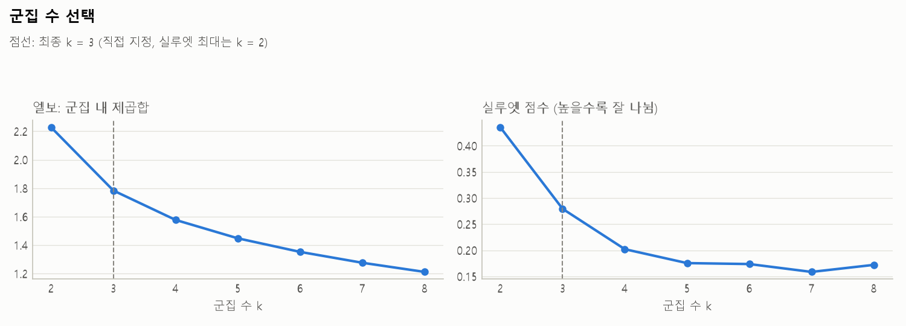
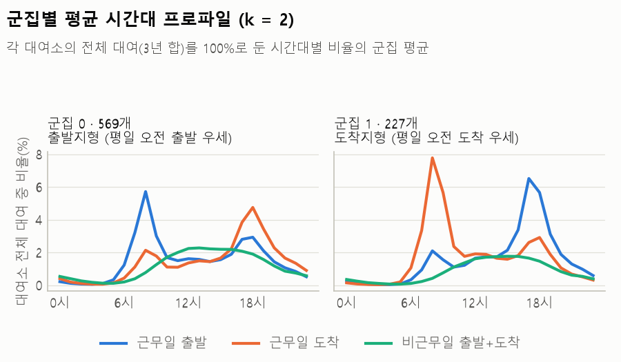
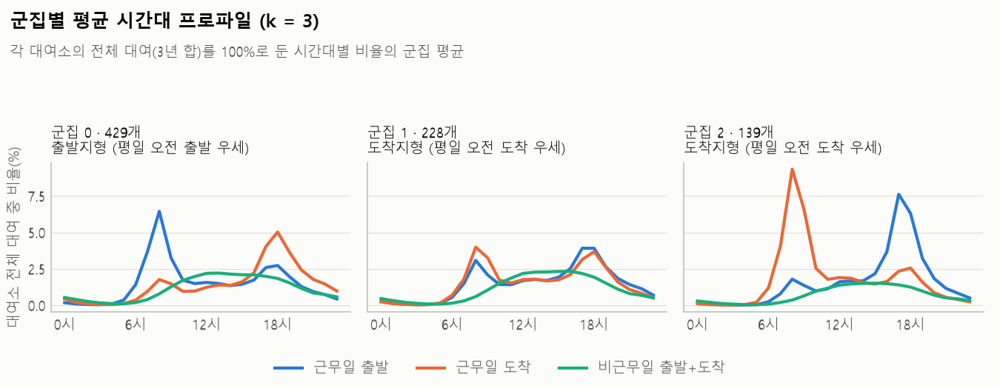
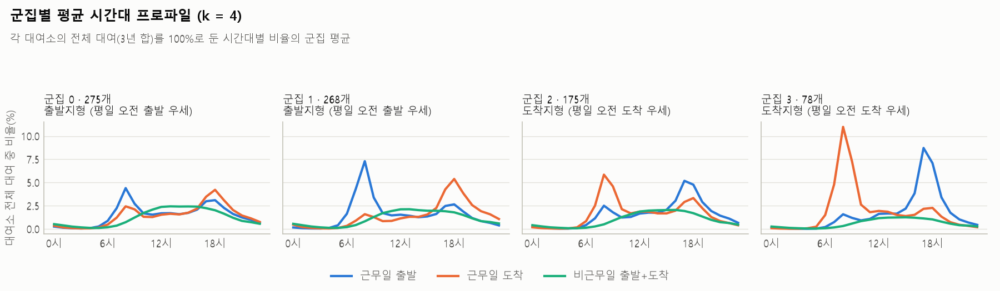
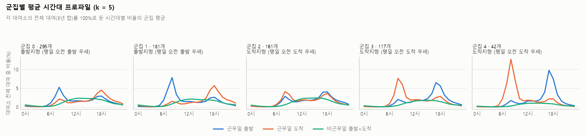
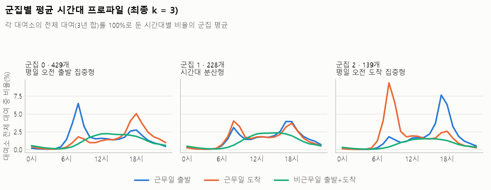

# 질문 1. 대여소 이용 패턴 유형

- 실행 일시: 2026-11-24 02:26
- 질문: 시간대와 요일에 따라 이용량은 어떻게 다르며, 대여소를 이용 패턴에 따라 몇 개 유형으로 나눌 수 있는가?
- 이 보고서는 **관찰(수치)**을 기록한다. 군집 이름은 자동 '제안'이며 그래프를 보고 확정한다.

## 1. 대상과 특성

- 대상: 2023~2025년 매년 출발+도착 1,000건 이상인 대여소 **796개** (전체 835개 중 39개 제외)
- 대상 대여소가 차지하는 대여 비중: 99.3% (출발+도착 기준)
- 특성: (출발/도착) × (근무일/비근무일) × 24시간 = 96개 비율. 대여소 규모의 영향을 없애고 모양만 비교한다.
- 운영 장애일(2025-08-05) 제외, 근무일 = 월~금 중 공휴일이 아닌 날

## 2. 군집 수 선택

|   k |   inertia |   silhouette |
|----:|----------:|-------------:|
|   2 |     2.227 |        0.435 |
|   3 |     1.783 |        0.279 |
|   4 |     1.577 |        0.202 |
|   5 |     1.448 |        0.175 |
|   6 |     1.352 |        0.174 |
|   7 |     1.276 |        0.159 |
|   8 |     1.212 |        0.172 |

- 실루엣 점수가 가장 높은 k: **2**
- 최종 k: **3** (직접 지정 — 근거는 3절 비교)
- 최종 군집 이름: 0 = 평일 오전 출발 집중형, 1 = 시간대 분산형, 2 = 평일 오전 도착 집중형
- 이름 확인: 각 이름이 오전 첨두 도착 비율 조건(평일 오전 출발 집중형 ≤ 0.4, 시간대 분산형 0.4~0.7, 평일 오전 도착 집중형 ≥ 0.7)과 일치

## 3. k별 군집 내용 비교

실루엣은 '가장 뚜렷하게 갈리는 구분'을 알려 주지만, 그 구분 안에 성격이 다른 대여소가 섞여 있을 수 있다. k를 늘렸을 때 새로 갈라지는 군집이 해석 가능한지 비교한다.

|   k |   실루엣 |   규칙과의 ARI | 군집 크기                      | 제안 이름                            |
|----:|------:|-----------:|:---------------------------|:---------------------------------|
|   2 | 0.435 |      0.419 | 569 / 227                  | 출발지형 / 도착지형                      |
|   3 | 0.279 |      0.559 | 429 / 228 / 139            | 출발지형 / 도착지형 / 도착지형               |
|   4 | 0.202 |      0.371 | 275 / 268 / 175 / 78       | 출발지형 / 출발지형 / 도착지형 / 도착지형        |
|   5 | 0.175 |      0.335 | 295 / 181 / 161 / 117 / 42 | 출발지형 / 출발지형 / 도착지형 / 도착지형 / 도착지형 |

- 규칙과의 ARI: 단순 규칙(비근무일형·오전 도착형·오전 출발형·혼합형)과 군집이 얼마나 같은지 (1 = 같음, 0 = 무관)

### k = 2

|   cluster |   대여소 |   하루 평균 대여(중앙값) |   비근무일/근무일 이용 비 |   오전 첨두 도착 비율 |   오후 첨두 도착 비율 | 이용 비중   | 제안 이름              | 이용 상위 대여소                                                                                                                                                              |
|----------:|------:|----------------:|----------------:|--------------:|--------------:|:--------|:-------------------|:-----------------------------------------------------------------------------------------------------------------------------------------------------------------------|
|         0 |   569 |            48.2 |            0.86 |          0.28 |          0.59 | 65.7%   | 출발지형 (평일 오전 출발 우세) | Hyde Park Corner, Hyde Park / Waterloo Station 3, Waterloo / Waterloo Station 1, Waterloo / Argyle Street, Kings Cross / Albert Gate, Hyde Park                        |
|         1 |   227 |            66.5 |            0.56 |          0.79 |          0.33 | 34.3%   | 도착지형 (평일 오전 도착 우세) | Wormwood Street, Liverpool Street / Hop Exchange, The Borough / Brushfield Street, Liverpool Street / St. James's Square, St. James's / Exhibition Road, Knightsbridge |

군집 × 규칙 교차표 (대여소 수):

|   cluster |   비근무일형 |   오전 도착형 |   오전 출발형 |   혼합형 |
|----------:|--------:|---------:|---------:|------:|
|         0 |     111 |        7 |      349 |   102 |
|         1 |       9 |      203 |        0 |    15 |

### k = 3

|   cluster |   대여소 |   하루 평균 대여(중앙값) |   비근무일/근무일 이용 비 |   오전 첨두 도착 비율 |   오후 첨두 도착 비율 | 이용 비중   | 제안 이름              | 이용 상위 대여소                                                                                                                                                  |
|----------:|------:|----------------:|----------------:|--------------:|--------------:|:--------|:-------------------|:-----------------------------------------------------------------------------------------------------------------------------------------------------------|
|         0 |   429 |            46.9 |            0.86 |          0.23 |          0.61 | 45.5%   | 출발지형 (평일 오전 출발 우세) | Waterloo Station 3, Waterloo / Waterloo Station 1, Waterloo / Argyle Street, Kings Cross / Islington Green, Angel / London Street, Paddington              |
|         1 |   228 |            64.3 |            0.79 |          0.57 |          0.47 | 34.5%   | 도착지형 (평일 오전 도착 우세) | Hyde Park Corner, Hyde Park / Wormwood Street, Liverpool Street / Hop Exchange, The Borough / Albert Gate, Hyde Park / Black Lion Gate, Kensington Gardens |
|         2 |   139 |            62.6 |            0.46 |          0.85 |          0.28 | 20.0%   | 도착지형 (평일 오전 도착 우세) | Brushfield Street, Liverpool Street / St. James's Square, St. James's / Soho Square, Soho / Queen Street 1, Bank / Cheapside, Bank                         |

군집 × 규칙 교차표 (대여소 수):

|   cluster |   비근무일형 |   오전 도착형 |   오전 출발형 |   혼합형 |
|----------:|--------:|---------:|---------:|------:|
|         0 |      73 |        0 |      343 |    13 |
|         1 |      47 |       72 |        6 |   103 |
|         2 |       0 |      138 |        0 |     1 |

### k = 4

|   cluster |   대여소 |   하루 평균 대여(중앙값) |   비근무일/근무일 이용 비 |   오전 첨두 도착 비율 |   오후 첨두 도착 비율 | 이용 비중   | 제안 이름              | 이용 상위 대여소                                                                                                                                                              |
|----------:|------:|----------------:|----------------:|--------------:|--------------:|:--------|:-------------------|:-----------------------------------------------------------------------------------------------------------------------------------------------------------------------|
|         0 |   275 |            51   |            0.89 |          0.37 |          0.55 | 33.5%   | 출발지형 (평일 오전 출발 우세) | Hyde Park Corner, Hyde Park / Albert Gate, Hyde Park / Black Lion Gate, Kensington Gardens / Tooley Street, Bermondsey / Battersea Power Station, Battersea Park       |
|         1 |   268 |            45.4 |            0.84 |          0.19 |          0.63 | 27.9%   | 출발지형 (평일 오전 출발 우세) | Waterloo Station 3, Waterloo / Waterloo Station 1, Waterloo / Argyle Street, Kings Cross / Eagle Wharf Road, Hoxton / Waterloo Station 2, Waterloo                     |
|         2 |   175 |            69.4 |            0.68 |          0.7  |          0.39 | 27.8%   | 도착지형 (평일 오전 도착 우세) | Wormwood Street, Liverpool Street / Hop Exchange, The Borough / Brushfield Street, Liverpool Street / Duke Street Hill, London Bridge / Exhibition Road, Knightsbridge |
|         3 |    78 |            59.1 |            0.4  |          0.88 |          0.23 | 10.8%   | 도착지형 (평일 오전 도착 우세) | St. James's Square, St. James's / Queen Street 1, Bank / Cheapside, Bank / Queen Street 2, Bank / Moorfields, Moorgate                                                 |

군집 × 규칙 교차표 (대여소 수):

|   cluster |   비근무일형 |   오전 도착형 |   오전 출발형 |   혼합형 |
|----------:|--------:|---------:|---------:|------:|
|         0 |      74 |        0 |      117 |    84 |
|         1 |      34 |        0 |      232 |     2 |
|         2 |      12 |      132 |        0 |    31 |
|         3 |       0 |       78 |        0 |     0 |

### k = 5

|   cluster |   대여소 |   하루 평균 대여(중앙값) |   비근무일/근무일 이용 비 |   오전 첨두 도착 비율 |   오후 첨두 도착 비율 | 이용 비중   | 제안 이름              | 이용 상위 대여소                                                                                                                                           |
|----------:|------:|----------------:|----------------:|--------------:|--------------:|:--------|:-------------------|:----------------------------------------------------------------------------------------------------------------------------------------------------|
|         0 |   295 |            46.4 |            0.88 |          0.31 |          0.58 | 30.9%   | 출발지형 (평일 오전 출발 우세) | Black Lion Gate, Kensington Gardens / Islington Green, Angel / London Street, Paddington / Baylis Road, Waterloo / Regent's Row, Haggerston         |
|         1 |   181 |            47.3 |            0.82 |          0.17 |          0.65 | 19.6%   | 출발지형 (평일 오전 출발 우세) | Waterloo Station 3, Waterloo / Waterloo Station 1, Waterloo / Argyle Street, Kings Cross / Eagle Wharf Road, Hoxton / Waterloo Station 2, Waterloo  |
|         2 |   161 |            70.8 |            0.79 |          0.6  |          0.46 | 26.7%   | 도착지형 (평일 오전 도착 우세) | Hyde Park Corner, Hyde Park / Hop Exchange, The Borough / Albert Gate, Hyde Park / Duke Street Hill, London Bridge / Exhibition Road, Knightsbridge |
|         3 |   117 |            64.8 |            0.54 |          0.81 |          0.31 | 16.6%   | 도착지형 (평일 오전 도착 우세) | Wormwood Street, Liverpool Street / Brushfield Street, Liverpool Street / Soho Square, Soho / Storey's Gate, Westminster / Crosswall, Tower         |
|         4 |    42 |            58.6 |            0.26 |          0.88 |          0.21 | 6.2%    | 도착지형 (평일 오전 도착 우세) | St. James's Square, St. James's / Queen Street 1, Bank / Cheapside, Bank / Queen Street 2, Bank / Moorfields, Moorgate                              |

군집 × 규칙 교차표 (대여소 수):

|   cluster |   비근무일형 |   오전 도착형 |   오전 출발형 |   혼합형 |
|----------:|--------:|---------:|---------:|------:|
|         0 |      74 |        0 |      183 |    38 |
|         1 |      14 |        0 |      166 |     1 |
|         2 |      31 |       54 |        0 |    76 |
|         3 |       1 |      114 |        0 |     2 |
|         4 |       0 |       42 |        0 |     0 |

- 비근무일/근무일 이용 비: 비근무일 하루 평균 이용 ÷ 근무일 하루 평균 이용 (1보다 크면 쉬는 날에 더 많이 쓰임)
- 오전·오후 첨두 도착 비율: 근무일 7~9시대·16~18시대의 출발+도착 중 도착의 비율 (0.5보다 크면 도착 우세)

## 4. 최종 군집 (k = 3)

|   cluster |   대여소 |   하루 평균 대여(중앙값) |   비근무일/근무일 이용 비 |   오전 첨두 도착 비율 |   오후 첨두 도착 비율 | 이용 비중   | 제안 이름        | 이용 상위 대여소                                                                                                                                                  |
|----------:|------:|----------------:|----------------:|--------------:|--------------:|:--------|:-------------|:-----------------------------------------------------------------------------------------------------------------------------------------------------------|
|         0 |   429 |            46.9 |            0.86 |          0.23 |          0.61 | 45.5%   | 평일 오전 출발 집중형 | Waterloo Station 3, Waterloo / Waterloo Station 1, Waterloo / Argyle Street, Kings Cross / Islington Green, Angel / London Street, Paddington              |
|         1 |   228 |            64.3 |            0.79 |          0.57 |          0.47 | 34.5%   | 시간대 분산형      | Hyde Park Corner, Hyde Park / Wormwood Street, Liverpool Street / Hop Exchange, The Borough / Albert Gate, Hyde Park / Black Lion Gate, Kensington Gardens |
|         2 |   139 |            62.6 |            0.46 |          0.85 |          0.28 | 20.0%   | 평일 오전 도착 집중형 | Brushfield Street, Liverpool Street / St. James's Square, St. James's / Soho Square, Soho / Queen Street 1, Bank / Cheapside, Bank                         |

## 5. 검증 (최종 k)

### 5.1 초기값(시드) 안정성

- 시드 10개로 다시 군집화했을 때 최종 결과와의 ARI: 평균 0.996, 최소 0.995
- ARI는 두 군집 결과가 같으면 1, 무작위 수준이면 0에 가깝다.

### 5.2 연도 안정성

|   연도 | 같은 중심점에 배정했을 때 유형 일치율   |   ARI (배정) |   ARI (그 해만으로 다시 군집화) |
|-----:|:------------------------|-----------:|----------------------:|
| 2023 | 94.3%                   |      0.843 |                 0.853 |
| 2024 | 96.2%                   |      0.896 |                 0.879 |
| 2025 | 95.5%                   |      0.866 |                 0.854 |

- '배정': 3년 합으로 만든 군집 중심에 각 연도의 프로파일을 배정해, 대여소의 유형이 해마다 유지되는지 본다.

### 5.3 전처리 기준 민감도

| 변형                | 유형 일치율   |   ARI (배정) |   ARI (다시 군집화) |
|:------------------|:---------|-----------:|---------------:|
| 짧은 왕복 2분 이하 추가 제외 | 100.0%   |          1 |              1 |
| 3시간 초과 추가 제외      | 100.0%   |          1 |              1 |

### 5.4 단순 규칙과 비교

- 규칙: 비근무일/근무일 이용 비 ≥ 1.0 → 비근무일형, 아니면 오전 첨두 도착 비율 ≥ 0.6 → 오전 도착형, ≤ 0.4 → 오전 출발형, 나머지 혼합형
- 군집 결과와 규칙의 ARI: **0.559**

군집 × 규칙 교차표 (대여소 수):

|   cluster |   비근무일형 |   오전 도착형 |   오전 출발형 |   혼합형 |
|----------:|--------:|---------:|---------:|------:|
|         0 |      73 |        0 |      343 |    13 |
|         1 |      47 |       72 |        6 |   103 |
|         2 |       0 |      138 |        0 |     1 |

## 6. 해석 작성 시 확인할 것

- 군집 이름은 그래프의 모양을 보고 확정한다. 같은 제안 이름이 둘 이상이면 규모·오후 패턴 차이로 구분한다.
- 대여소 이름에 Station·Park 등이 들어간 것은 참고만 한다. 좌표가 없어 주변 환경은 확인할 수 없다.
- 규칙과의 ARI가 높으면 '단순 지표 두 개로도 대부분 설명된다', 낮으면 '시간대 모양에 규칙이 놓치는 정보가 있다'는 뜻이다.

