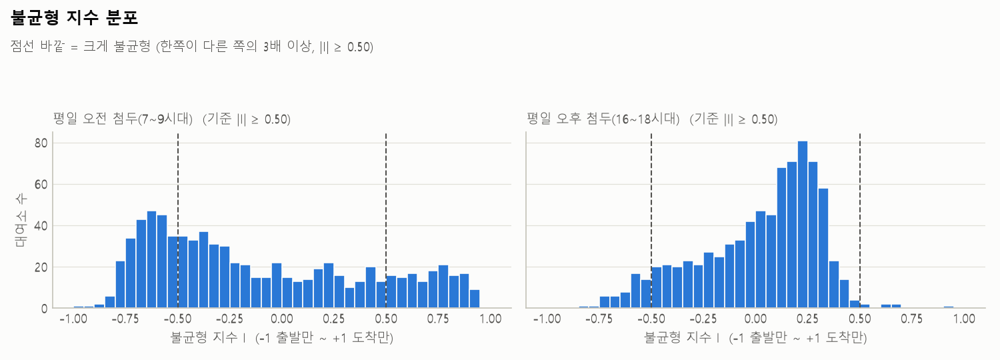
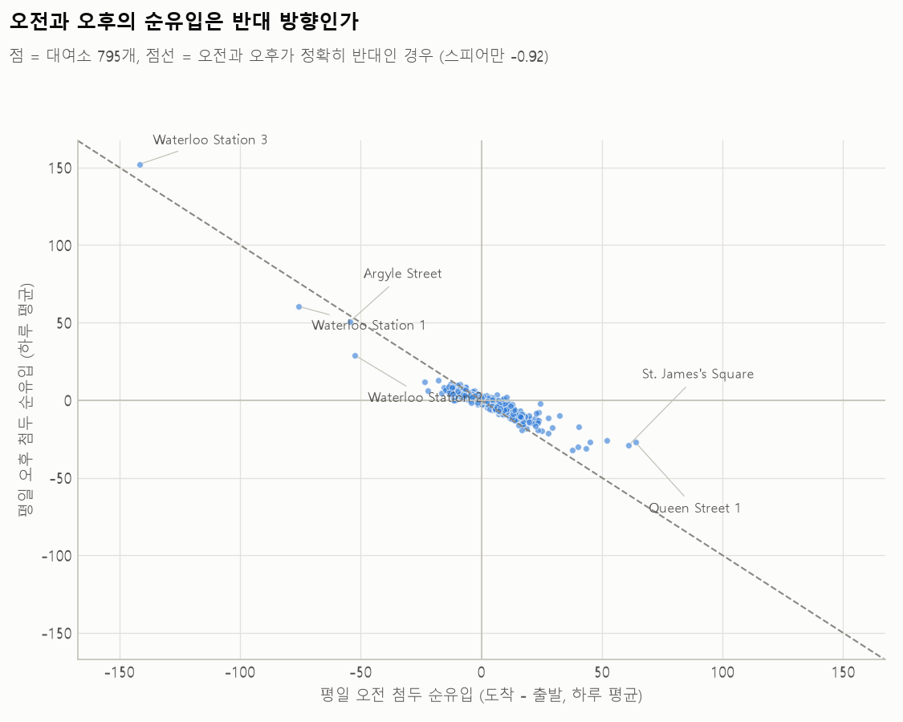
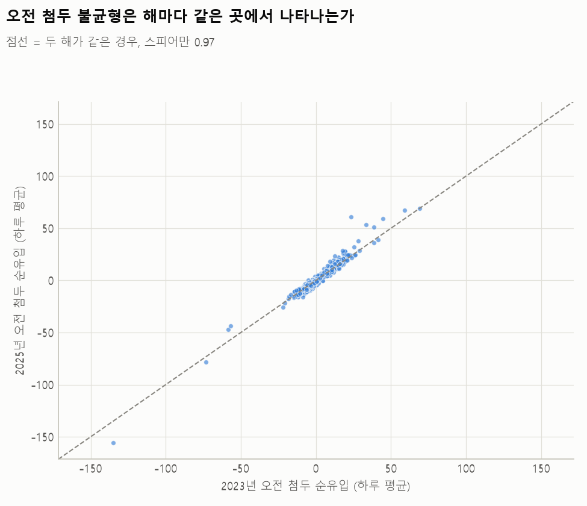

# 질문 2. 출발-도착 흐름과 불균형

- 실행 일시: 2026-11-24 02:30
- 질문: 출발-도착 대여소 쌍 중 이용이 많은 흐름은 무엇이며, 출발과 도착이 크게 불균형한 대여소는 어디인가?
- 운영 장애일(2025-08-05) 제외. 이 보고서는 **관찰(수치)**을 기록한다.

## 1. 정의

- 불균형 지수 I = (도착 − 출발) / (도착 + 출발). +1에 가까우면 도착만, −1에 가까우면 출발만 있음
- 순유입/일 = (도착 − 출발) / 해당 날짜 수. 하루 평균 쌓이거나(+) 빠지는(−) 자전거 수
- 판단 대상: 해당 시간대 출발+도착이 하루 평균 3건 이상인 대여소 (3년 평일 약 750일이면 2,000건 이상이라 지수가 우연에 크게 흔들리지 않음)
- **크게 불균형**: 한쪽이 다른 쪽의 **3배 이상** (|I| ≥ 0.50). 분포 순위(상위 몇 %)보다 뜻이 분명하고, 값이 같은 대여소가 많아도 흔들리지 않는다.

| 시간대               |   판단 대상 대여소 |   도착 우세 |   출발 우세 |   |I| 중앙값 |   |I| 90% 지점 |
|:------------------|------------:|--------:|--------:|----------:|-------------:|
| 평일 오전 첨두(7~9시대)   |         795 |     142 |     237 |     0.483 |        0.763 |
| 평일 오후 첨두(16~18시대) |         805 |       7 |      53 |     0.215 |        0.457 |
| 평일 하루 전체          |         822 |       0 |       0 |     0.023 |        0.085 |
| 주말·공휴일 하루 전체      |         817 |       0 |       0 |     0.023 |        0.069 |

기준을 바꿨을 때 '크게 불균형' 대여소 수:

| 시간대               |   2배 이상 (|I| ≥ 0.33) |   3배 이상 (|I| ≥ 0.50) |   4배 이상 (|I| ≥ 0.60) |
|:------------------|---------------------:|---------------------:|---------------------:|
| 평일 오전 첨두(7~9시대)   |                  543 |                  379 |                  268 |
| 평일 오후 첨두(16~18시대) |                  195 |                   60 |                   27 |
| 평일 하루 전체          |                    1 |                    0 |                    0 |
| 주말·공휴일 하루 전체      |                    1 |                    0 |                    0 |

## 2. 불균형 대여소

### 평일 오전 첨두(7~9시대)

출발이 더 많은 대여소 상위 10 (순유입이 가장 작은 순):

| 대여소                          |   출발/일 |   도착/일 |   순유입/일 |   지수 I | 판정    |
|:-----------------------------|-------:|-------:|--------:|-------:|:------|
| Waterloo Station 3, Waterloo |  145.1 |    3.4 |  -141.7 |  -0.95 | 출발 우세 |
| Waterloo Station 1, Waterloo |   90.6 |   14.7 |   -75.9 |  -0.72 | 출발 우세 |
| Argyle Street, Kings Cross   |   66.4 |   12   |   -54.4 |  -0.69 | 출발 우세 |
| Waterloo Station 2, Waterloo |   54   |    1.4 |   -52.6 |  -0.95 | 출발 우세 |
| Boston Place, Marylebone     |   34   |   10.4 |   -23.6 |  -0.53 | 출발 우세 |
| Eagle Wharf Road, Hoxton     |   29.3 |    7.2 |   -22.1 |  -0.61 | 출발 우세 |
| Doric Way, Somers Town       |   22.5 |    4.7 |   -17.8 |  -0.66 | 출발 우세 |
| Macclesfield Rd, St Lukes    |   20.2 |    3.8 |   -16.4 |  -0.68 | 출발 우세 |
| Maida Vale, Maida Vale       |   17.8 |    2.3 |   -15.6 |  -0.77 | 출발 우세 |
| Bonny Street, Camden Town    |   17.9 |    2.9 |   -14.9 |  -0.72 | 출발 우세 |

도착이 더 많은 대여소 상위 10:

| 대여소                                 |   출발/일 |   도착/일 |   순유입/일 |   지수 I | 판정    |
|:------------------------------------|-------:|-------:|--------:|-------:|:------|
| Queen Street 1, Bank                |   11.9 |   75.8 |    63.9 |   0.73 | 도착 우세 |
| St. James's Square, St. James's     |    6.7 |   67.8 |    61.1 |   0.82 | 도착 우세 |
| Holborn Circus, Holborn             |    5.6 |   57.8 |    52.1 |   0.82 | 도착 우세 |
| Moorfields, Moorgate                |   11.1 |   56.2 |    45.1 |   0.67 | 도착 우세 |
| Queen Street 2, Bank                |    7.7 |   51   |    43.3 |   0.74 | 도착 우세 |
| Brushfield Street, Liverpool Street |   10.9 |   51.2 |    40.3 |   0.65 | 도착 우세 |
| Newgate Street, St. Paul's          |    3.4 |   43.6 |    40.2 |   0.86 | 도착 우세 |
| Cheapside, Bank                     |    8.3 |   45.9 |    37.6 |   0.69 | 도착 우세 |
| Soho Square, Soho                   |    4.8 |   37.2 |    32.4 |   0.77 | 도착 우세 |
| St. Bride Street, Holborn           |    1.9 |   31.2 |    29.3 |   0.88 | 도착 우세 |

- '판정' 열이 '균형~보통'이면 순유입 규모는 커도 지수가 기준값에 못 미친 경우다.

### 평일 오후 첨두(16~18시대)

출발이 더 많은 대여소 상위 10 (순유입이 가장 작은 순):

| 대여소                             |   출발/일 |   도착/일 |   순유입/일 |   지수 I | 판정    |
|:--------------------------------|-------:|-------:|--------:|-------:|:------|
| Cheapside, Bank                 |   47   |   14.8 |   -32.1 |  -0.52 | 출발 우세 |
| Queen Street 2, Bank            |   41.4 |   10.6 |   -30.9 |  -0.59 | 출발 우세 |
| Newgate Street, St. Paul's      |   36.6 |    6.3 |   -30.3 |  -0.71 | 출발 우세 |
| St. James's Square, St. James's |   46   |   17   |   -29   |  -0.46 | 균형~보통 |
| Queen Street 1, Bank            |   42.2 |   15   |   -27.2 |  -0.48 | 균형~보통 |
| Moorfields, Moorgate            |   39.9 |   13   |   -26.9 |  -0.51 | 출발 우세 |
| Holborn Circus, Holborn         |   34.9 |    9   |   -25.9 |  -0.59 | 출발 우세 |
| Worship Street, Shoreditch      |   27   |    5.5 |   -21.4 |  -0.66 | 출발 우세 |
| Museum of London, Barbican      |   24.5 |    5   |   -19.5 |  -0.66 | 출발 우세 |
| New Fetter Lane, Holborn        |   23.9 |    4.6 |   -19.3 |  -0.68 | 출발 우세 |

도착이 더 많은 대여소 상위 10:

| 대여소                               |   출발/일 |   도착/일 |   순유입/일 |   지수 I | 판정    |
|:----------------------------------|-------:|-------:|--------:|-------:|:------|
| Waterloo Station 3, Waterloo      |    7.8 |  159.9 |   152.1 |   0.91 | 도착 우세 |
| Waterloo Station 1, Waterloo      |   13.5 |   74.1 |    60.6 |   0.69 | 도착 우세 |
| Argyle Street, Kings Cross        |   15.8 |   66.6 |    50.8 |   0.62 | 도착 우세 |
| Waterloo Station 2, Waterloo      |    6.8 |   35.9 |    29.1 |   0.68 | 도착 우세 |
| Doric Way, Somers Town            |    6.5 |   19.2 |    12.6 |   0.49 | 균형~보통 |
| Boston Place, Marylebone          |   11.2 |   23   |    11.8 |   0.35 | 균형~보통 |
| Canada Water Station, Rotherhithe |    6.5 |   16.9 |    10.5 |   0.45 | 균형~보통 |
| Belvedere Road 1, South Bank      |    6.8 |   17   |    10.2 |   0.43 | 균형~보통 |
| Birkenhead Street, King's Cross   |    7   |   16.7 |     9.6 |   0.41 | 균형~보통 |
| Strata, Elephant & Castle         |   10.9 |   19.8 |     8.9 |   0.29 | 균형~보통 |

- '판정' 열이 '균형~보통'이면 순유입 규모는 커도 지수가 기준값에 못 미친 경우다.

## 3. 오전·오후 상쇄

- 오전·오후 첨두 모두 판단 대상인 대여소 795개에서 오전 순유입과 오후 순유입의 상관: 피어슨 -0.929, 스피어만 -0.919
- 오전 첨두에 크게 불균형한 대여소 379개의 **평일 하루 전체** 불균형 지수: |I| 중앙값 0.035, |I| < 0.1인 대여소 321개 (85%)

## 4. 검증

### 4.1 연도 일관성

| 시간대               | 비교           |   순유입 순위 상관(스피어만) | 도착 상위 10개 겹침   | 출발 상위 10개 겹침   |
|:------------------|:-------------|------------------:|:---------------|:---------------|
| 평일 오전 첨두(7~9시대)   | 2023 vs 2024 |             0.982 | 9/10           | 8/10           |
| 평일 오전 첨두(7~9시대)   | 2024 vs 2025 |             0.982 | 9/10           | 7/10           |
| 평일 오후 첨두(16~18시대) | 2023 vs 2024 |             0.966 | 8/10           | 8/10           |
| 평일 오후 첨두(16~18시대) | 2024 vs 2025 |             0.97  | 8/10           | 9/10           |

### 4.2 전처리 기준 민감도

| 변형                |   오전 첨두 순유입 순위 상관 | 도착 상위 10개 겹침   | 출발 상위 10개 겹침   |
|:------------------|------------------:|:---------------|:---------------|
| 짧은 왕복 2분 이하 추가 제외 |                 1 | 10/10          | 10/10          |
| 3시간 초과 추가 제외      |                 1 | 10/10          | 10/10          |

### 4.3 질문 1 대여소 유형과의 관계 (오전 첨두 판정, 대여소 수)

| 유형              |   균형~보통 |   도착 우세 |   이용 적음(판단 제외) |   출발 우세 |
|:----------------|--------:|--------:|---------------:|--------:|
| 0. 평일 오전 출발 집중형 |     187 |       0 |              8 |     234 |
| 1. 시간대 분산형      |     193 |      27 |              7 |       1 |
| 2. 평일 오전 도착 집중형 |      28 |     111 |              0 |       0 |

## 5. 주요 흐름

출발-도착 대여소가 다른 흐름만 (평일 하루 평균 = 3년 합계 ÷ 평일 수):

### 평일 오전 첨두(7~9시대)

| 출발                           | 도착                                    |   3년 합계 |   평일 하루 평균 |
|:-----------------------------|:--------------------------------------|--------:|-----------:|
| Ackroyd Drive, Bow           | Maplin Street, Mile End               |    4135 |        5.5 |
| Monier Road, Hackney Wick    | Stratford Station, Stratford          |    2646 |        3.5 |
| Waterloo Station 3, Waterloo | Cheapside, Bank                       |    2490 |        3.3 |
| Waterloo Station 3, Waterloo | Newgate Street, St. Paul's            |    2484 |        3.3 |
| Waterloo Station 3, Waterloo | Queen Street 1, Bank                  |    2470 |        3.3 |
| Rainville Road, Hammersmith  | Barons Court Station, West Kensington |    2267 |        3   |
| Waterloo Station 3, Waterloo | Wormwood Street, Liverpool Street     |    2145 |        2.8 |
| Stainsby Road, Poplar        | Westferry DLR, Limehouse              |    2111 |        2.8 |
| Waterloo Station 3, Waterloo | Queen Victoria Street, St. Paul's     |    1970 |        2.6 |
| Waterloo Station 3, Waterloo | St. Bride Street, Holborn             |    1921 |        2.5 |

### 평일 오후 첨두(16~18시대)

| 출발                                  | 도착                           |   3년 합계 |   평일 하루 평균 |
|:------------------------------------|:-----------------------------|--------:|-----------:|
| Newgate Street, St. Paul's          | Waterloo Station 3, Waterloo |    3677 |        4.9 |
| Wormwood Street, Liverpool Street   | Waterloo Station 3, Waterloo |    2977 |        3.9 |
| Cheapside, Bank                     | Waterloo Station 3, Waterloo |    2767 |        3.7 |
| Maplin Street, Mile End             | Ackroyd Drive, Bow           |    2659 |        3.5 |
| Queen Street 1, Bank                | Waterloo Station 3, Waterloo |    2266 |        3   |
| Queen Street 2, Bank                | Waterloo Station 3, Waterloo |    2224 |        2.9 |
| Queen Victoria Street, St. Paul's   | Waterloo Station 3, Waterloo |    2093 |        2.8 |
| Godliman Street, St. Paul's         | Waterloo Station 3, Waterloo |    2088 |        2.8 |
| Finsbury Circus, Liverpool Street   | Waterloo Station 3, Waterloo |    2035 |        2.7 |
| Brushfield Street, Liverpool Street | Waterloo Station 3, Waterloo |    1871 |        2.5 |

오전 첨두 출발 우세 1위 `Waterloo Station 3, Waterloo`에서 출발한 대여의 도착지 상위 5 (이 대여소 오전 출발 중 비중):

| 도착                                |   3년 합계 |   비중(%) |
|:----------------------------------|--------:|--------:|
| Cheapside, Bank                   |    2490 |     2.3 |
| Newgate Street, St. Paul's        |    2484 |     2.3 |
| Queen Street 1, Bank              |    2470 |     2.3 |
| Wormwood Street, Liverpool Street |    2145 |     2   |
| Queen Victoria Street, St. Paul's |    1970 |     1.8 |

- 이 대여소의 오전 첨두 출발 도착지 수: 573곳

## 6. 해석 작성 시 확인할 것

- 불균형은 '이용 기록'의 차이다. 재고 정보가 없어 실제 자전거 부족·반납 불가가 있었는지는 알 수 없다.
- TfL의 재배치(트럭 이동)는 기록에 없다. 순유입은 이용자 이동만 반영한다.
- 대여소 이름(역, 업무지구)으로 해석할 때는 '이름에 근거한 추정'임을 밝힌다.

