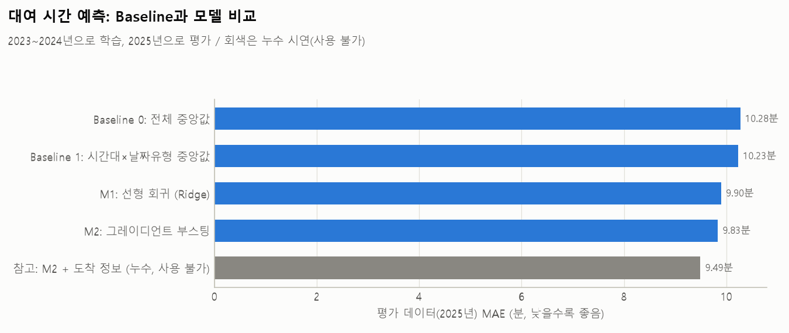
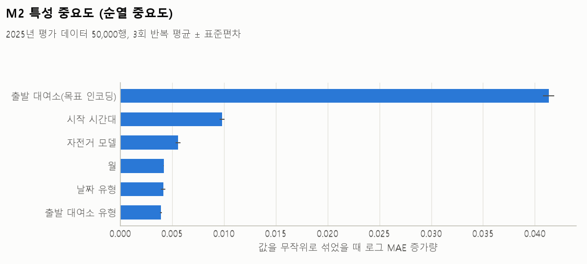
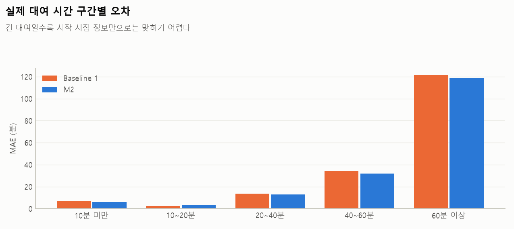

# 질문 3. 1회 대여 시간

- 실행 일시: 2026-11-23 17:27
- 질문: 1회 대여 시간은 시간대, 요일, 자전거 모델, 왕복 여부와 어떤 관련이 있는가?
- 데이터: `q3_sample.parquet` (분석 데이터의 약 5% 표본, trip_id 기준 추출, 운영 장애일 제외)
- 이 보고서는 **관찰(수치)**을 기록한다.

## 1. 설계

| 항목 | 내용 |
|---|---|
| Target | log(대여 시간[분]) — 오른쪽 꼬리가 길어 로그 변환, 평가는 분으로 되돌려 계산 |
| Train / Test | 2023·2024년 856,495행 / 2025년 449,714행 (시간 순서 분할) |
| Feature | 시작 시간대, 날짜 유형, 월, 자전거 모델, 출발 대여소 유형, 출발 대여소(목표 인코딩) |
| 출발 대여소 유형 | 학습 연도 자료만으로 K-means 재군집화 (k = 3, 질문 1과 같은 k). 이용이 적은 대여소는 '-1' |
| 제외한 정보 | 도착 대여소, 왕복 여부, 종료 시각(대여가 끝나야 알 수 있음), 연도(학습에 없는 해를 외삽) |
| 목표 인코딩 | 출발 대여소별 로그 대여 시간 평활 평균 (평활 50), 학습 데이터는 5겹 out-of-fold |

## 2. 결과

| 모델                         |   MAE(분) |   오차 중앙값(분) |   로그 MAE |   로그 R² |
|:---------------------------|---------:|------------:|---------:|--------:|
| Baseline 0: 전체 중앙값         |   10.277 |       6.348 |    0.611 |  -0.001 |
| Baseline 1: 시간대×날짜유형 중앙값   |   10.233 |       6.314 |    0.607 |   0.009 |
| M1: 선형 회귀 (Ridge)          |    9.898 |       5.875 |    0.584 |   0.08  |
| M2: 그레이디언트 부스팅             |    9.833 |       5.802 |    0.579 |   0.09  |
| 참고: M2 + 도착 정보 (누수, 사용 불가) |    9.492 |       5.459 |    0.553 |   0.158 |

- 가장 강한 Baseline(B1) 대비 M2의 MAE 변화: 10.23분 → 9.83분 (-3.9%)
- 누수 시연: 도착 정보(도착 대여소, 왕복 여부)를 넣으면 MAE 9.49분 (-3.5% vs M2). 대여 시작 시점에는 알 수 없는 정보로 얻은 개선이므로, 이 정보를 넣은 평가는 실제 성능을 부풀린다.

### 학습 vs 평가 (과적합 확인)

| 모델         |   학습 MAE(분) |   학습 오차 중앙값(분) |   학습 로그 MAE |   학습 로그 R² |   평가 MAE(분) |   평가 오차 중앙값(분) |   평가 로그 MAE |   평가 로그 R² |
|:-----------|------------:|---------------:|------------:|-----------:|------------:|---------------:|------------:|-----------:|
| M1 (Ridge) |       9.83  |          5.723 |       0.578 |      0.084 |       9.898 |          5.875 |       0.584 |       0.08 |
| M2 (부스팅)   |       9.742 |          5.628 |       0.571 |      0.101 |       9.833 |          5.802 |       0.579 |       0.09 |

### 전처리 기준 민감도

기준을 바꾼 데이터로 학습·평가를 다시 했을 때 Baseline 1 대비 M2의 개선이 유지되는가:

| 기준                |   평가 행 수 |   B1 MAE(분) |   M2 MAE(분) | B1 대비 변화   |
|:------------------|---------:|------------:|------------:|:-----------|
| 현재 기준             |  449,714 |      10.233 |       9.833 | -3.9%      |
| 짧은 왕복 2분 이하 추가 제외 |  448,926 |      10.23  |       9.825 | -4.0%      |
| 3시간 초과 추가 제외      |  448,576 |       9.192 |       8.796 | -4.3%      |

- 3시간 초과를 빼면 긴 꼬리가 줄어 두 모델의 MAE가 모두 작아진다. 비교할 것은 절대값이 아니라 B1 대비 변화다.

## 3. 특성 중요도 (M2)

| 특성             |   로그 MAE 증가 |   표준편차 |
|:---------------|------------:|-------:|
| 출발 대여소(목표 인코딩) |      0.0413 | 0.0005 |
| 시작 시간대         |      0.0098 | 0.0002 |
| 자전거 모델         |      0.0056 | 0.0002 |
| 월              |      0.0042 | 0      |
| 날짜 유형          |      0.0041 | 0.0002 |
| 출발 대여소 유형      |      0.0039 | 0.0001 |

## 4. 오류 분석 (M2, 2025년 평가 데이터)

실제 대여 시간 구간별 (평균 편향 = 예측 − 실제, 음수면 짧게 예측):

| 실제 구간   |      건수 |   MAE_M2 |   MAE_B1 |   평균_편향_M2 |
|:--------|--------:|---------:|---------:|-----------:|
| 10분 미만  | 159,242 |     6.09 |     6.93 |       6.07 |
| 10~20분  | 161,111 |     3.27 |     2.66 |      -1.22 |
| 20~40분  | 102,048 |    12.86 |    13.65 |     -12.74 |
| 40~60분  |  18,819 |    32.04 |    34.14 |     -32.04 |
| 60분 이상  |   8,494 |   118.92 |   121.71 |    -118.92 |

자전거 모델별:

| bike_model   |      건수 |   MAE_M2 |   MAE_B1 |   평균_편향_M2 |
|:-------------|--------:|---------:|---------:|-----------:|
| CLASSIC      | 368,706 |     9.87 |    10.29 |      -4.77 |
| PBSC_EBIKE   |  81,008 |     9.68 |     9.98 |      -4.74 |

날짜 유형별:

| day_type   |      건수 |   MAE_M2 |   MAE_B1 |   평균_편향_M2 |
|:-----------|--------:|---------:|---------:|-----------:|
| 공휴일        |   5,962 |    14.77 |    15.77 |      -7.82 |
| 주말         | 105,512 |    12.23 |    12.82 |      -6.08 |
| 평일         | 338,240 |     9    |     9.33 |      -4.3  |

왕복 여부별 (특성으로는 쓰지 않음, 오류 분석에만 사용):

| is_round_trip   |      건수 |   MAE_M2 |   MAE_B1 |   평균_편향_M2 |
|:----------------|--------:|---------:|---------:|-----------:|
| False           | 437,955 |     9.37 |     9.73 |      -4.31 |
| True            |  11,759 |    26.98 |    28.99 |     -21.72 |

## 5. 관련성: 전기자전거는 같은 조건에서도 더 오래 타는가

- 방법: 연도 × 시작 시간대 × 날짜 유형 × 출발 대여소 유형이 같은 '층' 안에서 전기자전거와 일반 자전거의 중앙값 차이를 구하고, 두 모델 중 적은 쪽 건수로 가중 평균 (두 모델 모두 20건 이상인 층만)
- 목적: 전기자전거가 특정 시간대·장소에 몰려서 생긴 차이인지(구성 효과), 같은 조건에서도 남는 차이인지 구분

|   연도 |   단순 중앙값 차이(분) |   층화 후 차이(가중 평균, 분) | 전기자전거가 더 긴 층 비율   |   비교한 층 수 |
|-----:|---------------:|--------------------:|:------------------|----------:|
| 2023 |           1.43 |                1.59 | 81%               |       124 |
| 2024 |           1.94 |                2.08 | 90%               |       137 |
| 2025 |           2.22 |                2.3  | 87%               |       166 |

## 6. 해석 작성 시 확인할 것

- 예측 성능이 Baseline보다 조금만 좋다면, '대여 시작 시점 정보로는 대여 시간을 많이 설명할 수 없다'는 것도 결과다.
- 긴 대여(40분 이상)의 오차가 큰 것은 이동 목적·경로 정보가 없기 때문으로 보인다 (가설).
- 층화 후에도 전기자전거 차이가 남는다면 시간·장소 구성만으로는 설명되지 않는다는 뜻이다. 거리 정보가 없어 원인(더 먼 이동 등)은 확인할 수 없다.

